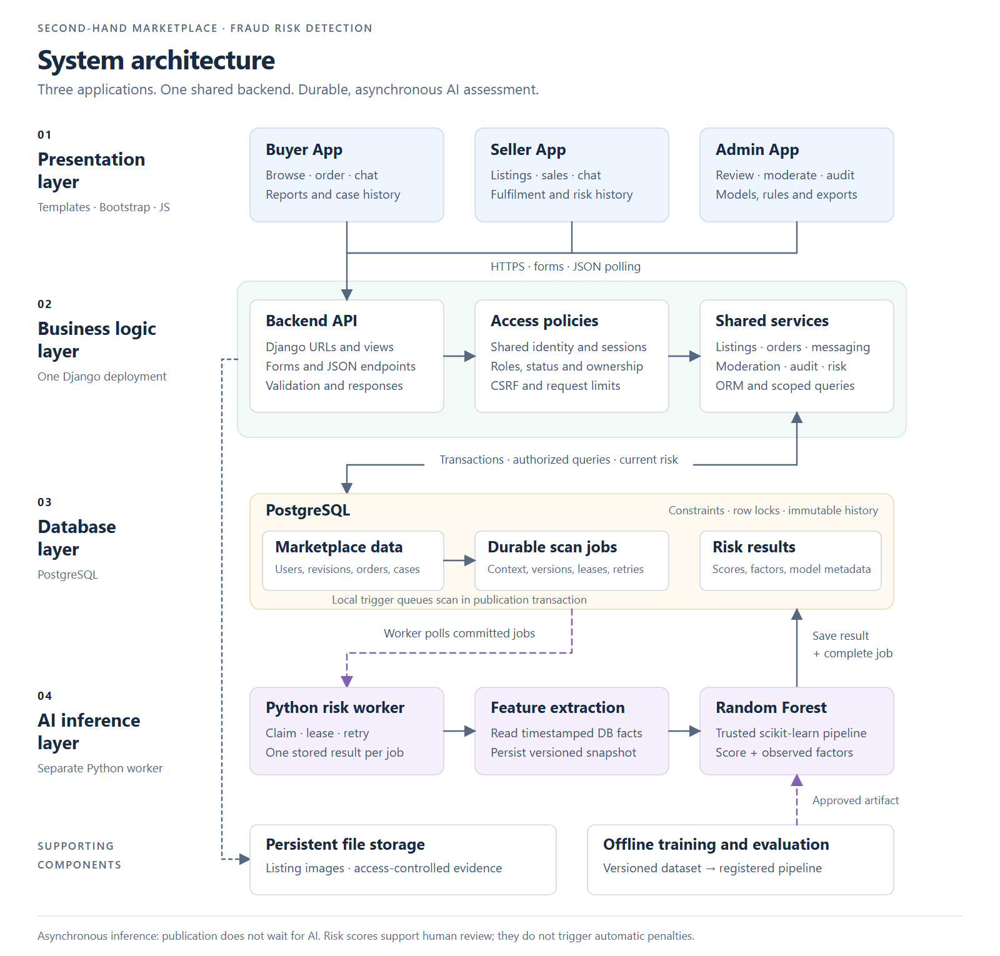
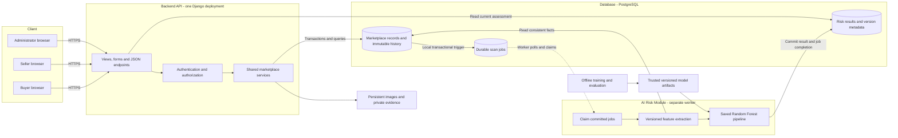
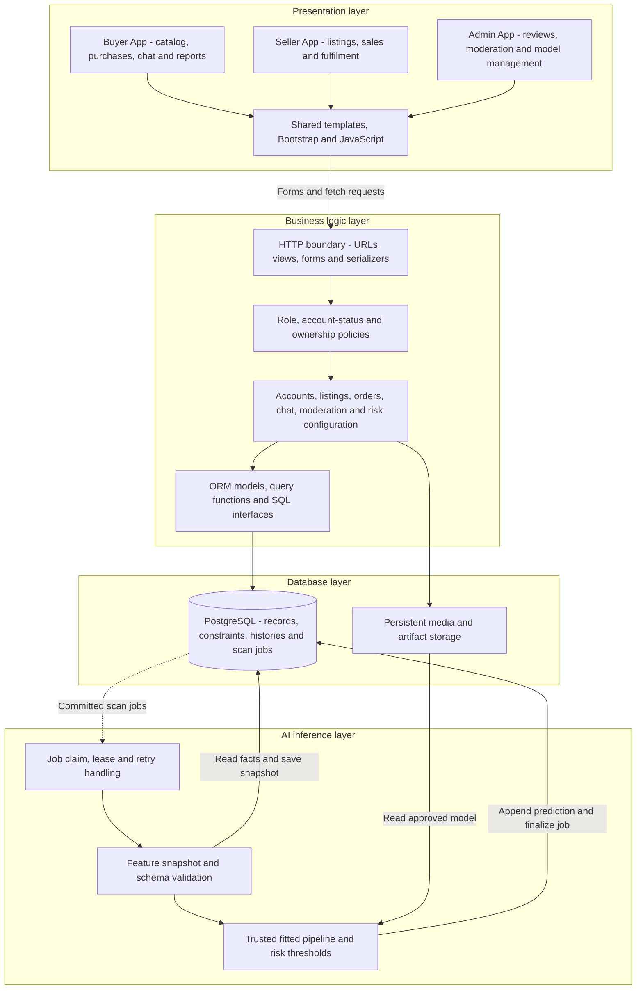
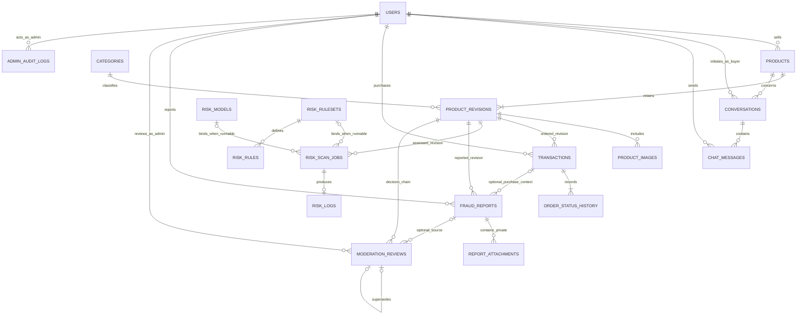
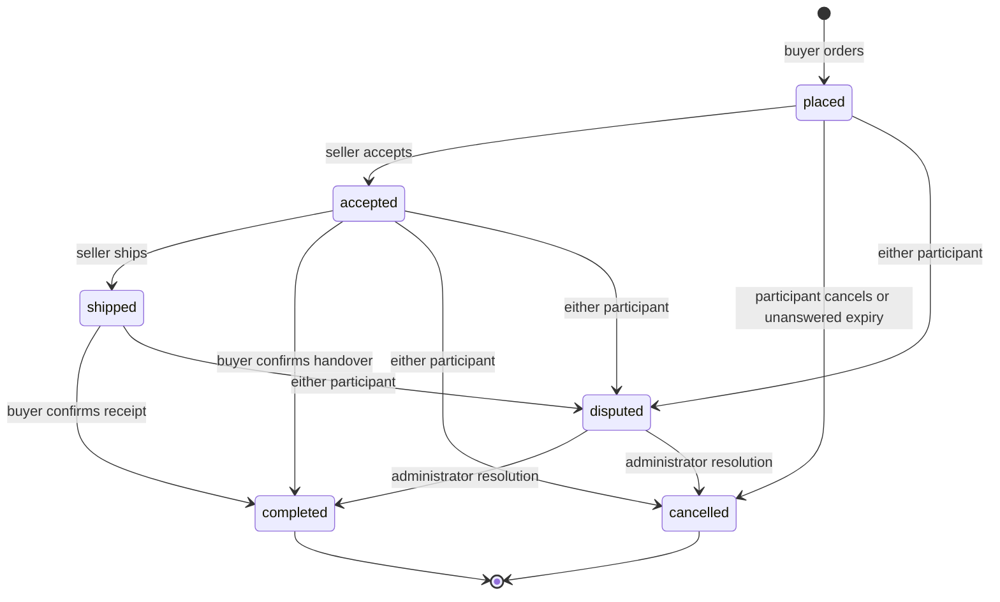
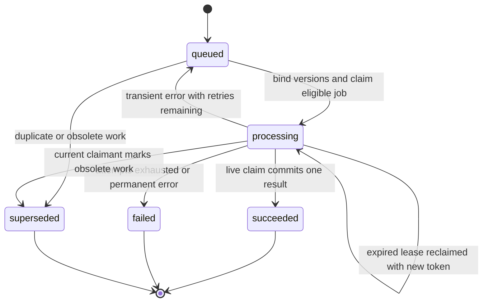
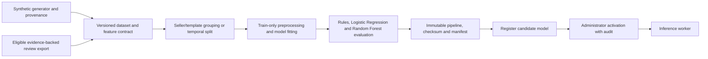
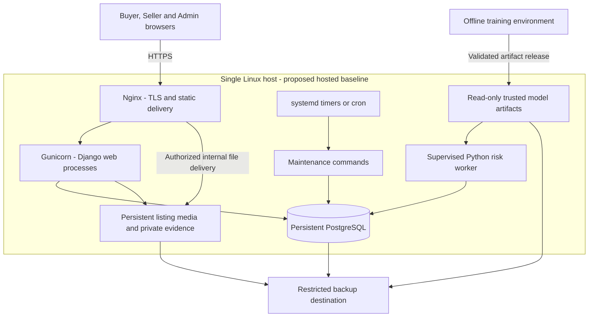

# System Architecture Design

**Detailed database design:** [ER diagrams, 3NF, relational schema and SQL](DATABASE_DESIGN.md)

**Project:** Second-hand Marketplace & Product Fraud Risk Detection Database Application  
**Architecture version:** 1.0 | **Updated:** 3 November 2026  
**Requirements:** [PRD v2.1](PRD.md) | **Technology baseline:** [TECH_STACK.md](TECH_STACK.md)  
**Status:** Proposed implementation architecture. The repository currently contains planning documents and package placeholders; the components below are not yet implemented or verified.

**Navigation:** [High-level diagram](#2-high-level-architecture-diagram) · [Layers](#3-layered-architecture) · [Database](#6-database-architecture) · [AI inference](#8-ai-inference-architecture) · [Deployment](#11-deployment-architecture) · [Delivery sequence](#143-delivery-sequence)

## 1. Architectural Decision

Build a **modular Django application with three presentation modules, one shared PostgreSQL database and a separate Python AI worker**. Buyer, Seller and Admin have separate routes, screens and permissions. Shared services execute marketplace operations for all three applications.

The web backend handles HTTP requests and database transactions. PostgreSQL durably records work for the AI module. The worker reads committed jobs, runs a trusted scikit-learn pipeline and saves risk results. Offline training is a separate workflow.

This design meets the course project's database, AI and three-application requirements with a small number of deployable processes. It follows the stack already proposed in `TECH_STACK.md`; Django remains a design recommendation until implementation begins.

| Decision | Baseline | Reason |
| --- | --- | --- |
| Application structure | One modular backend; three application entry points | Reuse rules and identity while maintaining distinct workflows |
| Browser UI | Django Templates, Bootstrap and small JavaScript enhancements | Server-rendered forms, responsive screens and polling fit P0 |
| Backend API | Django HTTP views, form POSTs and selected JSON endpoints | One interface to authentication and business services |
| Business operations | Explicit Python service functions | Make permissions, transactions and state changes reviewable |
| Persistence | PostgreSQL with ORM queries and versioned SQL migrations | Enforce relational integrity, locks, constraints and searchable history |
| Background work | PostgreSQL job table and dedicated worker | Persist scan requests in the listing transaction |
| AI inference | Saved preprocessing/Random Forest pipeline in the worker | Keep CPU work and model failures outside web requests |
| Training | Offline, versioned dataset and evaluation pipeline | Reproducible experiments and explicit model promotion |
| Files | Persistent local storage with separate public/private access | Appropriate for a single-host demonstration |

## 2. High-Level Architecture Diagram



[Open full-size PNG](docs/diagrams/system-architecture.png) · [Open editable SVG](docs/diagrams/system-architecture.svg)



The main path is **Client → Backend API → Database → AI Risk Module → Database → Backend → Client**. The database-to-AI connection represents worker polling. PostgreSQL triggers only insert local job records; they never execute Python inference or call an external AI service. The browser gets a publication response before the assessment completes.

## 3. Layered Architecture



| Layer | Owns | Boundary |
| --- | --- | --- |
| Presentation | Screens, navigation, accessible risk badges, form feedback and polling | Has no authority to assign roles, calculate trusted totals or enforce order transitions |
| Business logic | Input validation, authorization, state machines, transactions, audits and query orchestration | All entry points use shared services for business mutations |
| Database | Relational facts, immutable revisions, constraints, search, queue durability and historical evidence | Runtime database credentials cannot erase protected history |
| AI inference | Job execution, consistent feature snapshots, trusted model loading and versioned output | Produces advisory risk results; moderation remains an administrator action |

Data access is a sublayer of the business backend. File storage supports the database and AI layers but stores bytes rather than authoritative marketplace relationships. Offline training produces artifacts for inference; it does not run as part of these browser request layers.

## 4. Application and Module Boundaries

### 4.1 Three Applications

| Application | URL namespace | Core workflows | Access |
| --- | --- | --- | --- |
| `buyer_app` | `/` | Public search/details; registration/login; purchases; conversations; reports and own case history | Browsing is public; buyer membership protects buyer actions |
| `seller_app` | `/sell/` | Registration/login; listing drafts/revisions; images; own risk history; sales; fulfilment and conversations | Seller membership and object ownership |
| `admin_app` | `/admin-app/` | Restricted login; review queue; evidence; decisions; disputes; audits; models/rules and exports | Separately provisioned administrator membership |

All three apps share one custom user model, Django groups and database-backed sessions. A buyer/seller account can explicitly enable its other marketplace role. Changing the app URL or navigation never adds a role. P0 administrator identities are separate from marketplace participants.

### 4.2 Shared Backend Components

| Module | Responsibility | Illustrative operations |
| --- | --- | --- |
| `accounts` | Email-login identity, role memberships, status and session workflows | `register_member`, `enable_marketplace_role`, `change_password` |
| `marketplace.services.listings` | Drafts, immutable revisions, publication and soft removal | `publish_listing`, `revise_listing`, `withdraw_listing` |
| `marketplace.services.orders` | Purchase agreements, state transitions, idempotency and expiry | `place_order`, `transition_order`, `expire_placed_orders` |
| `marketplace.services.messaging` | Participant-scoped conversations and message actions | `get_or_create_conversation`, `send_message`, `mark_received_messages_read` |
| `marketplace.services.moderation` | Reports, private evidence, canonical reviews, disputes and account/listing actions | `submit_report`, `record_decision`, `resolve_dispute`, `block_member` |
| `marketplace.queries` | Authorized read models, search, dashboards and history | `search_catalog`, `buyer_orders`, `admin_review_queue` |
| `risk` | Job/result models, feature extraction, model/rule management and risk queries | `run_risk_worker`, `current_risk`, `activate_model`, `publish_ruleset` |
| `ml` | Dataset generation/export, splitting, training and evaluation | Offline scripts and manifests |
| `config` | Settings, root URLs, logging and deployment entry points | Environment-specific configuration |

Views validate request shape and pass the authenticated actor to a service. Services recheck business permissions, obtain necessary locks and commit related records together. Query functions scope data to the caller before pagination or serialization. Templates format service/query output.

Keep view modules independent: one app must not call another app's views. Reuse services and query contracts. The worker imports shared feature/data code and never depends on browser templates. Marketplace mutations rely on database triggers for scan enqueueing, avoiding an inference dependency inside order/listing requests.

## 5. HTTP and Backend API Design

The backend API is the Django request boundary, including HTML form handlers. A separate REST framework is unnecessary for the P0 interface. Use JSON for chat polling and risk-status refreshes.

The following routes are proposed contracts, not implemented endpoints. `<id>` represents a server-validated identifier.

| Method | Example route | Purpose | Required boundary |
| --- | --- | --- | --- |
| GET | `/listings/` | Paginated search and filters | Public visible catalog |
| GET | `/listings/<id>/` | Listing and current risk summary | Public visibility policy or authorized history access |
| POST | `/listings/<id>/orders/` | Place an order | Active buyer; active seller; availability; idempotency |
| POST | `/orders/<id>/actions/` | Confirm, cancel or dispute | Buyer participant and allowed transition |
| POST | `/listings/<id>/reports/` | Submit a revision-linked report | Buyer membership; not own listing; valid optional order |
| POST | `/sell/listings/` | Create a draft | Active seller |
| POST | `/sell/listings/<id>/publish/` | Publish/revise content | Active owning seller; no protected sale/order |
| POST | `/sell/orders/<id>/actions/` | Accept, ship, cancel or dispute | Seller participant and allowed transition |
| GET | `/<app>/conversations/<id>/messages/?after_id=<cursor>` | Poll messages | Buyer/seller app role and conversation participation |
| POST | `/<app>/conversations/<id>/messages/` | Send a message | Active participant; length/rate limits |
| POST | `/<app>/conversations/<id>/read/` | Update incoming read receipts | Receiving participant only |
| GET | `/listings/<id>/risk/` | Poll a public assessment summary | Same listing visibility policy as details |
| GET | `/sell/listings/<id>/risk-history/` | Inspect own assessment history | Owning seller |
| GET | `/<app>/reports/<id>/attachments/<attachment_id>/` | Fetch private evidence | Reporter in Buyer App or authorized administrator in Admin App |
| GET | `/admin-app/reviews/` | Deduplicated review queue | Administrator |
| POST | `/admin-app/listings/<id>/decisions/` | Append a moderation decision | Administrator; target revision; reason and evidence summary |
| POST | `/admin-app/models/<id>/activate/` | Activate/roll back to registered model | Administrator; compatibility checks; audit |
| POST | `/admin-app/rulesets/<id>/publish/` | Publish immutable rule version | Administrator; validated thresholds; audit |
| POST | `/admin-app/exports/` | Create a versioned dataset export | Administrator; restricted output; audit |

Conversation routes above use `/conversations/` for buyers and `/sell/conversations/` for sellers. Marketplace authentication is shared at `/login/` and `/register/`; administrator sign-in remains `/admin-app/login/`. Legacy app-prefixed bookmarks redirect to their canonical equivalents.

Use Django sessions, CSRF-protected POSTs, validated return URLs and POST/redirect/GET for successful form actions. GET requests are read-only. JSON failures return stable error codes, a safe message and a request ID. Use `400` for invalid fields, `401` for unauthenticated JSON requests, `403` for forbidden actions, `404` where revealing a private object's existence is inappropriate, `409` for stale state/idempotency conflicts and `429` for throttling. HTML login flows may redirect instead of returning `401`.

An order request carries a buyer-scoped idempotency key and expected listing revision. Derive the actor from the session and the seller from the product. Hash canonical request facts, including the revision. A replay with the same key and fingerprint returns the original order; different facts return `409`. If a listing changed before purchase, return `409` so the buyer can review its new terms.

Public risk responses expose state, score/level when current, assessment time, revision and safe observed factors. They exclude feature snapshots containing private profile facts, report evidence and storage paths.

## 6. Database Architecture

### 6.1 Domain Relationships

This overview covers the 18 P0 domain tables from PRD section 7.1. It shows major relationships; exact columns, all foreign keys and deletion rules belong in the implementation ERD/data dictionary and migrations.



Additional Django infrastructure tables store groups, memberships, permissions and sessions. P1 adds seller appeals and in-app notifications after P0 passes.

### 6.2 Record Ownership and History

| Data family | Tables | Design rule |
| --- | --- | --- |
| Identity | `users` and Django auth relations | One identity and explicit memberships; case-insensitive unique email |
| Catalog | `categories`, `products`, `product_revisions`, `product_images` | Product owns seller/status/context; immutable revision owns content and image associations |
| Messaging | `conversations`, `chat_messages` | Unique product/buyer conversation; seller derived from product |
| Purchase agreement | `transactions`, `order_status_history` | One product per order; revision is the immutable purchase fact |
| Risk configuration | `risk_models`, `risk_rulesets`, `risk_rules` | Immutable registered/published contents; audited activation state |
| Risk execution | `risk_scan_jobs`, `risk_logs` | Durable context-bound work and at most one immutable result per job |
| Reports and decisions | `fraud_reports`, `report_attachments`, `moderation_reviews` | Private evidence; one append-only decision chain per revision |
| Privileged accountability | `admin_audit_logs` | Append-only actor, target, reason and before/after record |

`transactions` is the PRD's order-table name. It represents the purchase/fulfilment agreement and does not store payment verification or escrow.

The detailed audit schema must include a typed `transaction_id` target for administrator dispute resolutions, in addition to the PRD's listed user/product/report/review/model/ruleset targets. This is an explicit schema refinement; audit an order resolution against its actual order rather than relying on free-text identifiers.

Keep core operational facts in 3NF. Feature snapshots, frozen order revisions and audit records intentionally preserve historical evidence; their JSON fields do not replace relational keys or constraints. Use UTC-aware timestamps and display the configured local timezone. Use exact decimal money values and one explicitly configured currency.

### 6.3 Composite Revision Mapping

Retain the PRD's `(product_id, revision_no)` primary key. Store both fields in orders, jobs, images, reports and reviews, with database composite foreign keys. The product's current-revision reference must target its own revision and be deferrable so product/revision creation is atomic.

Django 5.2 cannot point an ordinary `ForeignKey` at a composite primary key. Use explicit component fields, deliberate query helpers and custom SQL migrations for these relationships; keep Django migration state synchronized. Do not rely on the internal `ForeignObject` API to create database constraints. This limitation is documented in [Django's composite-key guidance](https://docs.djangoproject.com/en/5.2/topics/composite-primary-key/).

Allow a null current revision only while constructing an unpublished draft; a published product must reference a saved revision. Create the product and initial revision in one transaction. Changing to surrogate revision IDs would require an explicit coordinated PRD/ERD/schema decision.

### 6.4 Critical Constraints and Transactions

| Guarantee | Database enforcement | Service responsibility |
| --- | --- | --- |
| One sale per product | Partial unique index on `transactions(product_id)` where `status <> 'cancelled'` | Lock product; validate visible/available status, active participants and expected revision |
| Request replay | Unique `(buyer_id, request_key)` | Compare request fingerprint and return original outcome |
| Revision ownership | Composite foreign keys | Allocate next revision under product lock; reject prohibited edits |
| Order history | State/immutability triggers and retained foreign keys | Change order, product availability and history atomically |
| Canonical moderation | One root per revision; one successor per predecessor; target/chronology checks | Lock product; append correction and audit in one transaction |
| Model/rule activation | Partial unique indexes allow at most one active row of each kind | Serialize configuration changes; validate compatibility; audit and create rescan obligation |
| Job deduplication | Separate bound/unbound unique indexes; both model/ruleset IDs null or both set | Bind configuration atomically and coalesce collisions |
| Result deduplication | Unique `risk_logs.job_id` | Check current claim/lease before inserting result and completing job |
| Audit retention | Runtime privileges and append-only protections | Fail the privileged mutation if its audit insert fails |

Use explicit service transactions rather than holding a transaction for an entire page render. Django's `atomic()` provides the application transaction boundary. A process-memory callback is not the durable scan queue; the database trigger inserts the job before commit. See [Django transaction behavior](https://docs.djangoproject.com/en/5.2/topics/db/transactions/).

All services use a documented lock order. For operations involving account status and a product, lock affected user rows in ID order, then product, then order/review rows. Order expiry and fulfilment follow the same product-before-order order. Configuration operations use a shared transaction-level advisory lock before model/ruleset rows. Job claim/finalization uses job locks; it must not take product locks after locking a job. Feature snapshots read product facts through a consistent database snapshot. Retry deadlocks as a bounded whole transaction where the request is idempotent.

### 6.5 Query Models and Indexes

- `current_listing_risk`: validate revision, context, active versions and age; derive assessment state consistently for all apps.
- `admin_review_queue`: union open report targets and current high-risk listings; group by product while retaining target revisions and case counts.
- `seller_order_history`: join seller-owned products, ordered revisions and order events with actor-scoped access.
- Search: GIN index over title/description search vectors; query current revisions and apply visibility/category/price/condition/location/risk filters. Use a stable secondary product ID sort.
- Supporting B-tree indexes: product seller/status/filter fields; conversation message cursor; buyer/seller order history; report status/assignment/time; job status/retry/lease; revision creation times and seller history lookups.

Use database views or shared query functions for read models; views alone do not authorize a caller. Keep `EXPLAIN ANALYZE` examples and index decisions tied to measured seeded workloads.

## 7. Core Runtime Workflows

### 7.1 Publish a Listing and Assess Risk

```mermaid
sequenceDiagram
    actor Seller
    participant Web as Seller App / shared service
    participant Files as File storage
    participant DB as PostgreSQL
    participant Worker as AI worker
    actor Buyer

    Seller->>Web: Publish content and images
    Web->>Web: Validate role, ownership, fields and uploads
    Web->>Files: Write new immutable validated files
    Web->>DB: Begin; lock actor/product; check editability
    Web->>DB: Insert revision/images; advance current revision
    DB->>DB: Trigger inserts deduplicated scan job
    Web->>DB: Commit
    Web-->>Seller: Published; assessment pending
    Worker->>DB: Claim committed job with new token and lease
    Worker->>DB: Bind versions; save consistent feature snapshot
    Worker->>Worker: Run trusted pipeline and apply pinned thresholds
    Worker->>DB: Check live claim; insert result; mark succeeded; commit
    Buyer->>Web: Load listing or refresh risk
    Web->>DB: Query current revision/context/version/age
    Web-->>Buyer: Current risk summary or explicit unassessed state
```

File writes occur before the database references them because filesystem and PostgreSQL do not share one transaction. If the database transaction fails, files may be orphaned and are cleaned later after reference/grace-period checks. A failed file write prevents publication. Existing revision files are never overwritten. Concurrent revisions allocate their numbers while holding the product lock.

### 7.2 Place an Order Safely

1. Authenticate the buyer and validate the request key/fingerprint. Look up an existing buyer/request key first: return the original order for a matching replay, or reject a different fingerprint. Replaying an existing result is an authorized history read, not a new purchase.
2. If no prior request exists, begin a transaction. Lock relevant user rows in ID order, then the product. Recheck the buyer/request key after waiting for locks; resolve a newly committed matching replay before checking availability or changed account/listing state.
3. For genuinely new work, verify buyer membership, active participants, non-self-purchase, visibility, availability and expected revision. Derive seller and ordered terms server-side.
4. Insert the `placed` order against the current revision, append its initial history event and set availability to `reserved`.
5. Commit. A competing buyer sees the reserved state or the unique-index conflict and receives `409`.

Concurrent requests using the same buyer key on different products can still meet the unique constraint. Handle that constraint error outside the failed transaction, read the winning request and apply the same fingerprint rule. Never convert an integrity failure into a second order.

### 7.3 Order State Machine



Every transition locks and rechecks current state/actor, appends history and adjusts availability in one transaction. A repeated already-applied action returns the existing state without another event. Cancellation releases reservation; completion marks sold. **Visibility is independent**: neither transition restores an administrator-hidden listing. Expiry applies only to unanswered `placed` orders, initially after 48 hours.

### 7.4 Messaging, Reporting and Moderation

Messages use a product/buyer conversation shared by Buyer and Seller apps. Poll initially every five seconds with bounded pages and an increasing message cursor. Only the participants can read; only active participants can send; only the recipient can mark incoming messages read. The risk model does not inspect private chat.

A report selects the purchased revision when linked to the reporter's order, otherwise the current revision. Save private evidence with access-controlled metadata. Administrators manage report workflow separately from the canonical listing-revision decision chain.

For a decision or correction, determine any combined account-status actions and lock affected user rows in ID order before locking the product. Validate the chain head and append a review referencing its immediate predecessor. Commit the verdict, any moderation action, required audit event and durable seller-history rescan obligation together. A newer `unresolved` verdict removes that revision from eligible training labels. Dismissal and absence of reports never create a legitimate label. Report resolution is an explicit audited transition; it is not implied solely by a prediction or verdict insertion.

## 8. AI Inference Architecture

### 8.1 Worker Pipeline and Feature Contract

The worker operates on a job identity containing:

```text
(product_id, revision_no, context_version, model_id, ruleset_id)
```

`context_version` increases for new safety evidence, explicit rescans and scheduled refresh events. Revisions identify content; context identifies the evidence/refresh generation for that content.

| Feature group | Inputs | Reproducibility requirement |
| --- | --- | --- |
| Price context | Price ratio, category/condition reference median and count | Earlier comparable records only; exclude target product; flag fewer than 15 comparables |
| Listing text | Versioned suspicious-phrase count and normalized duplicate-text count | Frozen keyword/normalization definitions; earlier same-seller duplicates within defined 30-day window |
| Seller history | Account age, prior confirmed fraud count, seven-day posting frequency | Facts known at `feature_as_of`; exclude target verdict and future evidence |
| Listing evidence | Revision image count and location difference | Preserve assessed images, seller location reference and missing indicators |

Bind the model and ruleset together before execution. Extract all database-derived features in a short, consistent read snapshot and persist `feature_as_of`, schema version, feature values, missing flags and aggregate reference facts under a valid job claim. If a crash occurs before snapshot persistence, a new attempt may extract a new snapshot; once persisted, retries reuse it. Run inference after releasing feature-extraction transaction locks.

Temporal queries must resolve moderation chains as known at `feature_as_of` and exclude later events. Reference-price selection needs a documented rule for multiple revisions of one comparable product so edits do not inflate the comparison sample.

Load only trusted registered artifacts with verified checksum, expected feature schema, fraud-class mapping and compatible pinned dependencies. Cache loaded pipelines by immutable version/checksum, not by a mutable `latest.joblib` path. `joblib` loading can execute code, and scikit-learn does not support arbitrary cross-version model loading; these constraints inform the trusted artifact boundary. See [scikit-learn model persistence](https://scikit-learn.org/stable/model_persistence.html).

Calculate `risk_score = round(100 * fraud_class_score)` and validate `0..100`. Apply the job's pinned thresholds, initially low `0..39`, medium `40..74`, high `75..100`. Preserve observed warning factors separately from optional model explanations. The result is an advisory risk indicator, not a verified real-world fraud probability.

### 8.2 Durable Jobs, Leases and Retries



- Claim eligible jobs in short transactions with `FOR UPDATE SKIP LOCKED`; persist a fresh token, attempt number and lease expiry. This locking mode is suitable for queue consumers, as described in [PostgreSQL's locking clause](https://www.postgresql.org/docs/18/sql-select.html#SQL-FOR-UPDATE-SHARE).
- If no compatible active model/ruleset exists, leave a job queued with both IDs null. Unbound work does not consume inference retry attempts. When configuration becomes available, bind atomically; coalesce any existing matching bound job.
- Deduplicate unbound jobs on revision/context and bound jobs on revision/context/model/ruleset. Enforce both-null-or-both-bound configuration with a check constraint.
- Every snapshot write, heartbeat, failure update and finalization checks token, `processing` state and an unexpired lease using a live database clock such as `clock_timestamp()`. Do not use a transaction-start timestamp for a lease that may expire while waiting for a lock. Replaced or expired workers cannot modify the job.
- Use configurable polling, lease duration, heartbeat and bounded exponential retry delays. Start with at most three execution attempts; choose lease timings after measuring feature/inference duration.
- Finalization locks the job, verifies the claim, inserts one risk log and marks success in one transaction. Unique `job_id` makes repeated execution safe. Queue consumption is at least once; committed output is deduplicated.
- P0 high-risk alerts are derived from current results in the review queue. P1 notifications require a unique recipient/source-event key so retries do not duplicate delivery.
- A permanently failed job remains visible to operators. An explicit administrator retry creates a new audited context instead of editing old prediction history.

### 8.3 Assessment Freshness and UI States

A prediction is current only when all conditions hold at read time:

```text
job.product_id       = requested product
job.revision_no      = product.current_revision_no
job.context_version  = product.context_version
job.model_id         = active model
job.ruleset_id       = active ruleset
job.status           = succeeded
feature_as_of        >= database_now - configured_max_age
feature_schema       = schema expected by the bound model
```

The initial maximum age is 24 hours, measured from the feature snapshot, not from a delayed completion timestamp. A historical result may finish successfully after a new revision/context exists, but cannot become the current assessment.

| UI state | Meaning | Display |
| --- | --- | --- |
| `ready` | A current successful result exists | Current score, risk label, assessment time and caution |
| `scanning` | No current result; current work has a live processing lease | Assessment running; no low-risk styling |
| `pending` | No current result; queued/unbound/retry work exists | Awaiting assessment/configuration; no numeric default |
| `failed` | Current assessment attempt failed permanently with no runnable successor | Assessment unavailable; safe retry guidance |
| `stale` | Only old revision/context/version/expired results exist and no current runnable work | Previous assessment outdated; do not present it as current |

Use this precedence consistently. When old history exists while a refresh is queued/running, show `pending`/`scanning` and optionally identify the prior assessment as historical. A never-assessed listing without a job is `pending` with an operator diagnostic, never low risk. An expired lease is pending recovery rather than actively scanning. The low-risk search filter admits only `ready` low-risk results; an unassessed filter includes all other states.

### 8.4 Rescans and Durable Batch Scheduling

| Trigger | Scope | Durable identity |
| --- | --- | --- |
| Publication/material edit | New current listing revision | Revision/context and bound/unbound job key |
| Confirmed seller-history change | Affected available seller listings | Moderation event ID plus product ID |
| Model activation/rollback or ruleset publication | Available listings | Configuration audit event ID plus product ID |
| Explicit administrator rescan | Selected listing | Audited request ID plus product ID |
| Daily refresh | Available listings | Product ID plus configured refresh date |

Add a proposed **`risk_rescan_campaigns` infrastructure table** alongside the 18 PRD domain tables. Its minimum fields are campaign ID, unique source-event key, event type, immutable scope/cutoff, status, cursor, attempt/error metadata and timestamps. This is a deliberate schema addition to make required batched rescan recovery concrete; include it in the final ERD/data dictionary. Django session and throttle infrastructure are also separate from the domain-table count.

Model/rule activation and relevant moderation actions insert their campaign row with the required audit event in the same transaction. A scheduled management command resumes campaigns using bounded product-ID batches. For each product, lock it, recheck eligibility and existing event work, advance context once and let the queue trigger create the job; associate its unique source-event key before commit. Put context advancement, job event-key assignment and campaign cursor progress in the same batch transaction. A repeated campaign batch must recognize previously processed event/product pairs before advancing context. Preserve source keys even when work is superseded/coalesced.

Define a shared database enqueue function for trigger and maintenance paths so conflict handling cannot create two jobs for one context. Daily campaign dates use an explicit configured timezone; freeze the run cutoff so retries do not expand the same campaign indefinitely. Version changes invalidate old assessments immediately through read-time matching, while campaign processing catches up. A reconciliation command checks relevant audit events for missing campaign obligations and reports or repairs inconsistencies idempotently.

## 9. Offline Training and Model Lifecycle



1. Generate/export timestamped records with provenance, synthetic flags, feature schema and labels. Exclude private messages, contact details and report attachments.
2. For project reviews, resolve the latest effective canonical verdict at the export cutoff. Include only eligible evidence-backed `fraud`/`legitimate` labels; a newer unresolved correction excludes the revision.
3. Split seller/template/duplicate groups before fitting preprocessing or tuning. Use approximately 70/15/15 for the synthetic prototype and documented temporal holdouts for real records. Rebuild aggregate features using preceding information only.
4. Fit preprocessing and classifier as one pipeline. Compare the three methods on identical partitions and keep final test data untouched until evaluation. The split-first/pipeline approach follows [scikit-learn's leakage guidance](https://scikit-learn.org/stable/common_pitfalls.html).
5. Record precision, recall, F1, average precision, confusion matrices, sample counts, false positives and synthetic/real slices. Synthetic-only measurements support a prototype claim.
6. Register the artifact, checksum, feature schema, class map, dataset/split/generator versions, seed, code revision, dependency manifest and evaluation report as immutable metadata.
7. Administrator activation checks compatibility and trusted artifact provenance, serializes configuration, writes an audit and creates the rescan campaign. Preserve the former artifact for explicit audited rollback. Retraining always creates a new version.

Training is an operator-run offline process with read-only access to an approved export. It does not modify live marketplace records, automatically promote models or consume unreviewed reports as confirmed labels. Changing feature definitions requires a new feature schema and compatible retrained model; changing display thresholds requires a new ruleset.

## 10. Storage, Security and Privacy Boundaries

### 10.1 Authorization Policy

| Actor/status | New activity | Retained access |
| --- | --- | --- |
| Visitor | Browse visible public listing summaries | No private history |
| Active buyer | Order, contact sellers and report under Buyer App policy | Own orders, conversations and report status/evidence |
| Active seller | Publish/edit own eligible listings and fulfil sales | Own listing/risk history, sales and conversations |
| Dual-role member | Buyer and seller actions evaluated in their respective apps | Combined authorized history; no self-purchase/conversation/report |
| Blocked member | Cannot publish, purchase, send chat or enable another role | Own history/notices; existing fulfilment, cancellation, disputes and evidence as permitted |
| Deactivated member | Cannot initiate marketplace activity or enable roles | Authenticated own history/evidence and existing-order obligations remain accessible under the finalized account policy |
| Administrator | Review, moderate, resolve disputes and manage configuration/exports | Authorized evidence and audited administrative history |

Do not map marketplace blocking to a blanket Django authentication disablement: blocked members still need permitted history and existing-order workflows. A blanket role-required check also cannot override these obligation-specific exceptions. Every direct object request must enforce ownership/participation, and client-supplied actor/role/seller IDs are never authoritative.

### 10.2 Files and Trust Zones

| Storage zone | Contents | Serving/access rule |
| --- | --- | --- |
| Static assets | Local Bootstrap, CSS, JavaScript and site assets | Public, immutable deployment assets |
| Listing media | Validated immutable images and generated variants | Serve through visibility-aware routes; authorize participant history access for hidden revisions |
| Private evidence | Report attachments and other approved case files | Reporter/administrator authorization before access; no public media alias |
| Model artifacts | Trusted fitted pipelines and manifests | Worker read access; administrator references registered artifacts, no arbitrary upload/load |
| Dataset exports | Pseudonymous versioned datasets/manifests | Authorized administrator/operator access; outside public roots and Git |
| Temporary/orphan files | Incomplete uploads or unreferenced files | Inaccessible publicly; controlled cleanup after grace period/reference checks |

Accept only decoded JPEG/PNG/WebP within the PRD limits: 5 MB per image, six listing images and three report images. Also cap request body size, dimensions and decoded pixel count. Generate storage keys; never trust an uploaded path or extension. Preserve original private evidence bytes and checksum; derived display copies must not replace evidence. Strip unnecessary metadata from public listing derivatives. Replacements create new file identities.

For a single-host deployment, Nginx may deliver files using an internal location after Django authorizes the request. Protect historical listing images as well as private evidence so hiding a listing does not leave a public media bypass. Private responses use appropriate non-public cache headers.

### 10.3 Runtime and Database Controls

- HTTPS, secure/HTTP-only session cookies, suitable SameSite policy, CSRF protection, escaped templates and safe redirect validation.
- Custom email-login user configured before initial migrations; case-insensitive uniqueness; framework bcrypt-backed password hashing and validators.
- Explicit login/message/listing/report throttles shared across web processes. Select and pin a maintained implementation or a PostgreSQL-backed expiring counter; process-local counters are insufficient for a multi-process limit. Any additional throttle tables are infrastructure and must be documented.
- Separate migration/owner, web runtime and worker database roles. Web and worker receive only necessary table/function permissions; neither receives history-update/delete privileges or migration credentials.
- Database roles constrain each process, while object authorization remains the service's responsibility. Do not claim Django session users are separate PostgreSQL principals.
- Secrets come from environment configuration. Logs/exports exclude passwords, session tokens, raw private messages, sensitive evidence and local storage paths.
- Privileged changes require actor, reason and atomic audit insertion. Restrict grants on trigger/helper functions and schemas so ordinary runtime code cannot disable protections.

## 11. Deployment Architecture



| Environment | Web | Worker and schedules | Persistent state |
| --- | --- | --- | --- |
| Local Windows | Django development server | Separate worker terminal; Task Scheduler/manual commands | Local PostgreSQL and configured storage roots |
| Test | Isolated Django test settings | Controlled workers/clock/fixtures | Real PostgreSQL test database; isolated temporary media/artifacts |
| Hosted demonstration | Linux, Nginx and Gunicorn | Separately supervised worker; systemd timers/cron | Persistent PostgreSQL, media, exports and artifact directories |

The host is one failure domain; this baseline makes no high-availability claim. A supervisor restarts processes, but PostgreSQL jobs and leases provide work recovery. Bound web/worker database connections to the configured database capacity. Do not start workers or schedulers from Django web-process initialization.

Deploy in this order: back up state, install pinned compatible dependencies, run migrations with owner credentials, deploy static assets and trusted artifacts, restart web/worker services, verify app entry points/health and run a controlled end-to-end smoke check. Use `DEBUG=False`, configured hosts/CSRF origins and Django's deployment checks; see the [official deployment checklist](https://docs.djangoproject.com/en/5.2/howto/deployment/checklist/).

Application rollback must remain compatible with the applied schema. For destructive future migrations, use an explicit migration/restore plan instead of assuming an older binary can safely run. Model rollback is a separate audited configuration action.

## 12. Reliability, Monitoring and Recovery

| Failure | Expected behavior | Recovery/diagnostic |
| --- | --- | --- |
| AI worker stopped | Publication commits and scan stays queued | Restart worker; monitor oldest queued age |
| Database/queue insert fails during publication | Revision/current pointer/job transaction rolls back | Return safe failure; later clean orphan uploads |
| Worker crashes during inference | No partial committed prediction | Lease expires; new token reclaims; reuse saved snapshot |
| Old worker completes late | Claim validation rejects writes | Record safe lost-claim diagnostic |
| Model file missing/incompatible | No fabricated score | Reject activation where possible; failed/pending assessment and operator diagnostic |
| Model/rules change during a scan | Old result remains historical | Read-time version checks exclude it; campaign queues current work |
| Scheduler stopped | Expired results become stale at read time | Restart/resume campaigns; expired orders processed idempotently |
| Two buyers order simultaneously | Exactly one non-cancelled order commits | Other request gets availability conflict |
| Audit insert fails | Privileged mutation rolls back | Operator sees safe error plus request ID |
| Disk full/file unavailable | New upload publication fails; missing evidence is reported | Restore storage; reconcile references; never silently drop evidence |

Structured logs include request/job/campaign IDs, safe error codes, duration, attempt, queue age and model/ruleset versions. Monitor web error/latency rates, oldest queued job, expired processing leases, retry exhaustion, scan duration, stale listing count, campaign progress and disk capacity. Public liveness reports process responsiveness; restricted readiness/operations views check database/schema/storage and worker progress. Worker unavailability is degraded assessment capability, not a requirement to shut down browsing.

For the course baseline, take a coordinated backup before demonstrations/releases and on a documented daily schedule. Briefly stop writes and worker commits for a consistent PostgreSQL dump plus referenced media/artifact snapshot, or use a documented equivalent consistency method. Store a manifest with checksums, code/schema version and configuration references; keep credentials separately protected.

Restore into an isolated database and storage root. Verify representative users, orders, revision links, reports, evidence files, jobs and predictions before restarting a worker. Target recovery point/time must be documented after storage and host choices are known; no untested RPO/RTO is promised.

## 13. Verification and Requirement Coverage

These are design targets and acceptance plans, not measured results.

| Architectural check | Verification | PRD acceptance |
| --- | --- | --- |
| Shared identity and three distinct apps | Role matrix; direct route/object requests; cross-app workflow | AC-02, AC-21 to AC-23 |
| Revision and search integrity | PostgreSQL FK/trigger tests; immutable content; current-risk search | AC-01, AC-03, AC-04 |
| Durable and repeatable scans | Stop/restart worker; expire/reclaim lease; reject old claimant; duplicate execution | AC-05, AC-06 |
| Freshness/failure semantics | Change revision/context/model/rules; advance clock with scheduler stopped; force failure | AC-07, AC-08, AC-19 |
| Atomic order lifecycle | Competing PostgreSQL connections; repeated keys/actions; hidden cancellation and terminal sale | AC-09 to AC-11 |
| Private messaging/evidence | Participant/report ownership tests, read receipt isolation and upload limits | AC-12, AC-13 |
| Canonical labels and auditing | Concurrent decisions; unresolved correction; audit failure rollback | AC-14, AC-15 |
| Reproducible model | Frozen splits, leakage checks, dependency/schema validation and baseline metrics | AC-16 to AC-18 |
| Recoverable bulk work | Interrupt campaigns mid-batch; replay event; verify one context advancement per event/product | AC-19 |
| Recovery and integration | Separate restore drill and complete Buyer/Seller/Admin demo | AC-20, AC-23 |

Use PostgreSQL integration tests for locks, triggers, composite FKs, partial indexes and atomicity. Unit tests cover feature time boundaries, class mapping, risk-state derivation and transition policies. Manual UI checks cover warning language, mobile layout, keyboard access and clear pending/failed/stale states.

Measure the PRD targets on recorded hardware: search p95 at most one second for ten concurrent users/10,000 listings; warm scan p95 at most 15 seconds with one worker and at most 20 queued jobs. Measure full queue-to-result latency, not only model prediction time. Report actual results if targets are missed.

## 14. Implementation Boundaries and Next Deliverables

### 14.1 Suggested File Mapping

```text
config/                         settings, root URLs, WSGI, logging
accounts/                       custom user, membership/status services, auth pages
buyer_app/                      buyer URLs, views, forms and templates
seller_app/                     seller URLs, views, forms and templates
admin_app/                      administrator URLs, views, forms and templates
marketplace/
  models/                       catalog, orders, chat, reports, reviews and audit
  services/                     transactional business operations and policies
  queries/                      scoped catalog, history and dashboard reads
  migrations/                   schema, composite FKs, triggers, indexes and views
risk/
  models.py                     jobs/results, model/rule registry, campaign infrastructure
  features.py                   shared versioned feature extraction
  inference.py                  artifact validation/loading and inference
  services.py                   model/rule lifecycle and authorized rescan requests
  management/commands/          worker, campaign processing, refresh and reconciliation
ml/
  datasets/                     generator/export and provenance manifests
  training/                     grouped splits and fitted pipelines
  evaluation/                   baseline comparison and reproducibility reports
tests/                          PostgreSQL integration, permissions and feature checks
templates/                      shared page components
static/                         local Bootstrap, CSS and JavaScript
requirements/                   pinned application/training/development requirements
```

Names are proposed interfaces; most files above are not yet created. Storage roots, private datasets, model files and secrets stay outside public assets and Git.

### 14.2 Implementation Decisions

The 4 November 2026 [configuration decisions](docs/CONFIGURATION.md) and [marketplace-v1 feature contract](docs/FEATURE_CONTRACT.md) resolve the policy choices below. They distinguish requirements from implemented behavior and do not substitute for runtime acceptance evidence.

| Decision | Current architectural position | Required before |
| --- | --- | --- |
| Django baseline and exact pins | Use the families proposed in `TECH_STACK.md`; pin compatible patches | Dependency installation |
| Full physical schema | Preserve composite revisions; add campaign infrastructure explicitly | Initial migrations |
| Feature windows and comparable selection | Frozen `marketplace-v1`: 7-day publications, 30-day duplicates, 90-day same-category/condition/currency references, >=15 baseline, train-only imputation | Implement and verify shared extractor/training |
| Demo currency, language and locations | USD; English; configurable demo suggestions with free-text locations | Apply configuration to forms/generator |
| Deactivated-account access | Authenticated restricted history and existing-order/case obligations; no new trade, chat or role enabling | Implement and verify object-scoped policies |
| File retention and real participant evidence | Indefinite course-demo evidence/history retention; no automatic deletion; controlled real-data erasure remains future work | Collection of real data |
| Rate-limit/lease/batch parameters | Defaults fixed in configuration decision record; shared counters, 120-second lease, batch 100 | Abuse/recovery/performance verification |
| Backup capacity and recovery targets | Coordinated snapshots and tested restore | Hosted demonstration |

### 14.3 Delivery Sequence

1. Finalize physical ERD, data dictionary, state/policy contracts and schema mappings.
2. Implement PostgreSQL foundations, custom user and the three app entry points.
3. Implement revisioned listings, uploads, search and atomic scan enqueueing.
4. Complete orders, polling conversations and private reports across Buyer/Seller apps.
5. Produce the reproducible dataset, baselines and registered Random Forest pipeline.
6. Implement worker recovery, current-risk queries, Admin moderation/audits and rescan campaigns.
7. Run acceptance, concurrency, performance and restore checks; record evidence and limitations.
8. Add P1 appeals/notices/analytics only after the P0 workflow passes.

Future scaling follows measured bottlenecks: add worker consumers using the same job contract, move protected media to object storage when multiple hosts need it, and introduce a separate inference/API service only when independent deployment is justified. A richer frontend, broker-backed queue or WebSockets must preserve the same authorization, versioning, durability and audit guarantees.
