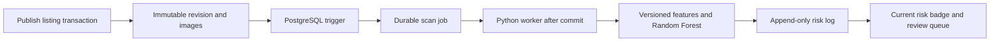
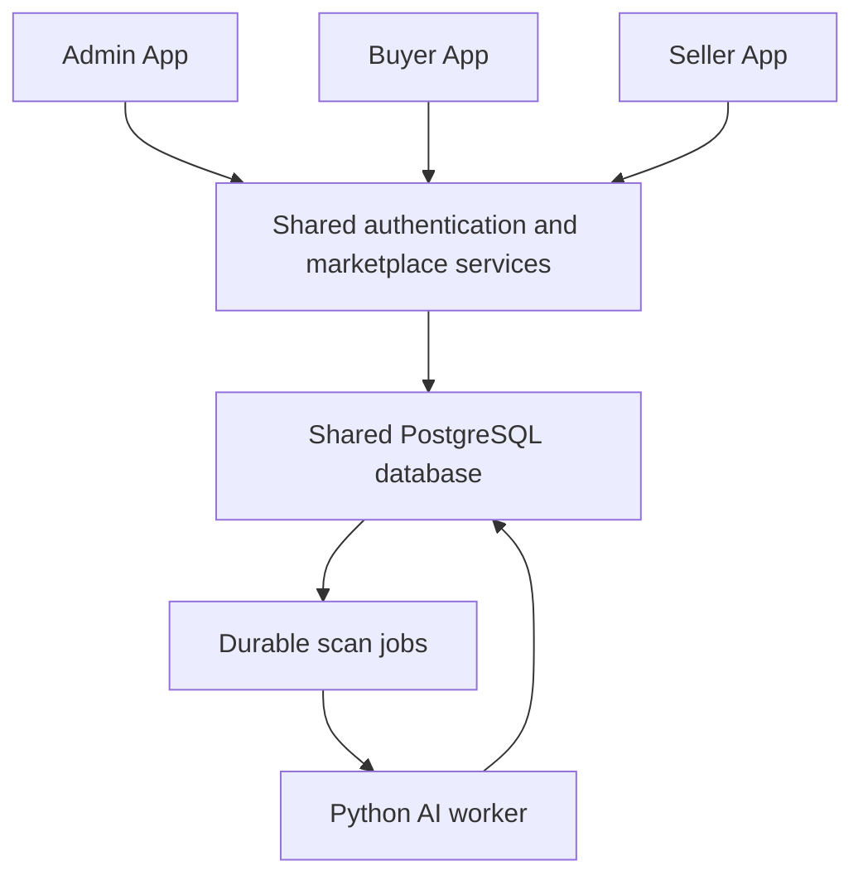

# Second-hand Marketplace & Product Fraud Risk Detection Database Application

**Product Requirements Document - Version 2.1**

**Course:** Database Application Project Development | **Updated:** 3 November 2026

**Status:** Revised project plan; implementation and evaluation are pending.

**System design:** [System Architecture Design](ARCHITECTURE.md)

**Database specification:** [Database Design](DATABASE_DESIGN.md), with [executable PostgreSQL scripts](database/README.md)

**Finalized P0 decisions:** [Configuration and restricted-account policy](docs/CONFIGURATION.md) and [versioned feature contract `marketplace-v1`](docs/FEATURE_CONTRACT.md), agreed 4 November 2026. These specify implementation requirements; verified runtime behavior is reported separately.

| Area | Project decision |
| --- | --- |
| Database | PostgreSQL; relational design, SQL constraints, triggers, indexes and transactions |
| AI module | A custom-trained fraud risk classifier for product listings |
| Learning algorithm | Random Forest, selected as the initial algorithm |
| AI library and language | scikit-learn and Python; free and open source |
| Proposed backend | Python with Django, using its authentication, ORM and migrations |
| Proposed frontend | Django templates, Bootstrap and small JavaScript enhancements |
| Application structure | Three separate web application modules: Admin App, Buyer App and Seller App |
| Background processing | A Python worker polling a durable PostgreSQL scan-job table |
| Deployment baseline | Three application modules hosted by one Django backend, plus one worker, shared PostgreSQL and local file storage |
| External service dependency | No paid AI API, payment gateway or external message broker required |

The project has three applications: Admin, Buyer and Seller. The proposed hosting baseline places them in one repository and Django deployment, with separate entry points, views, templates, navigation and permission checks. They share backend services and one database; three independent deployments are not required for the course baseline. PostgreSQL, Random Forest and scikit-learn are agreed technical choices. Pin supported dependency versions during implementation and record them with each trained model.

> Use scikit-learn to train a Random Forest model on the project's dataset, then load the fitted model to predict risk for new listings. The algorithm is the learning method; scikit-learn is the toolkit; the fitted classifier is the trained AI model.

## 1. Product Vision and Project Goals

Build a database-centric second-hand marketplace that helps buyers identify potentially risky listings and helps administrators prioritize evidence-based reviews. Assess listings when published or materially changed, and rescan them when relevant safety evidence changes.

The Buyer App supports discovery, purchasing, messaging and reporting. The Seller App supports listing management, fulfilment and buyer conversations. The Admin App supports moderation, risk monitoring and configuration. AI supplies a shared risk indicator and observed warning factors. A high score alone never blocks a member, removes a listing or establishes that fraud occurred.

The academic contribution is an integrated demonstration of relational database design, transactional business rules, reproducible machine learning and accountable moderation.

### 1.1 Required Outcomes

1. Produce an ER diagram, data dictionary, normalization discussion and executable PostgreSQL migrations/DDL.
2. Demonstrate three distinct applications and an end-to-end workflow across Buyer, Seller and Admin: registration, listing publication, search, messaging, ordering and reporting.
3. Train, evaluate, version and run a Random Forest classifier using scikit-learn.
4. Preserve listing revisions, prediction history, moderation evidence and order transitions.
5. Demonstrate concurrent order protection and recovery from a stopped or failed AI worker.
6. Report measured model performance and dataset limitations without presenting simulated results as real-world fraud accuracy.

### 1.2 Scope Priorities

| Priority | Meaning | Features |
| --- | --- | --- |
| P0 - required | Complete before the assessed core demonstration | Separate Admin/Buyer/Seller applications, role-based access, listings and revisions, search, polling chat, atomic orders, reports, risk worker, trained model, moderation, versioned rules, audit and evaluation |
| P1 - extension | Add after P0 acceptance checks pass | Seller appeals, in-app notifications and category-level analytics |
| P2 - future research | Document as future work | Semantic duplicate detection, image similarity, advanced NLP, external notifications and natural-language analytics |

P1 and P2 work must not delay a complete P0 workflow.

## 2. Users, Roles and Access

Use one shared identity store with explicit `buyer`, `seller` and `administrator` role memberships. The Buyer and Seller applications have separate registration/login entry points and role-specific workflows. A marketplace account may hold buyer access, seller access or both without duplicating its identity or email. Signing in or switching applications never grants a role by itself.

Buyer registration grants buyer access; seller registration grants seller access. An existing authenticated member may explicitly enable the other marketplace role through an account workflow. Administrator identities are provisioned separately and are not used for marketplace buying or selling in P0. Enforce these memberships through Django groups/permissions rather than duplicating buyer and seller credential tables.

| Actor | Allowed actions | Access boundary |
| --- | --- | --- |
| Visitor | Browse public Buyer App listings and their risk summaries | Cannot order, message or submit reports |
| Active buyer | Use the Buyer App to search, contact sellers, order, confirm receipt, report concerns and view own purchases | Requires buyer membership; cannot buy own listing or access others' orders/evidence |
| Active seller | Use the Seller App to publish/edit own listings, manage sales and reply to buyers | Requires seller membership; cannot change scores, verdicts or another seller's listings |
| Administrator | Use the Admin App to review cases, moderate accounts/listings, publish rules and manage models/exports | Requires provisioned administrator membership; every privileged change records an actor and reason |
| Blocked member | Read own history and moderation notices; submit evidence or an appeal where supported | Cannot publish, purchase or send chat messages |

Administrator privileges are provisioned through a trusted management command or existing administrator. Public registration and profile updates must never assign an administrator role. An analyst role is deferred; P0 dataset exports are administrator-only.

## 3. Product Experience and Functional Requirements

### 3.1 Accounts and Profiles

- **AUTH-01:** Register using a unique, case-insensitive email, full name and password. Store only a framework-managed password hash; configure a bcrypt-backed Django hasher and password validation.
- **AUTH-02:** Support login, logout, password change and server-side session invalidation. Use session cookies and CSRF protection for browser actions.
- **AUTH-03:** Enforce ownership, role and account status on the server for every protected action, including direct requests to an object's URL.
- **AUTH-04:** Support `active`, `blocked` and `deactivated` account status. Deactivation is a soft action and preserves orders, reports, reviews and audit history.
- **AUTH-05:** Show public profile information and account age. Keep email, contact details and private evidence outside public profiles and dataset exports.
- **AUTH-06:** Use one identity and explicit role memberships across the three apps. Reject duplicate-email registration by directing existing users to sign in; adding buyer/seller access requires an authenticated, explicit action. Public flows must never grant administrator access. Blocked/deactivated users cannot enable additional roles.

### 3.2 Listing Creation, Revisions and Search

- **LIST-01:** A listing contains title, description, category, condition, positive price, optional original price, location and zero to six images. Use one configured currency for the demonstration and display it explicitly.
- **LIST-02:** Use conditions `like_new`, `good`, `fair` and `poor`. Explain missing photos as limited listing evidence, not proof of fraud.
- **LIST-03:** Separate availability (`draft`, `available`, `reserved`, `sold`) from visibility (`visible`, `removed_by_seller`, `removed_by_admin`). A hidden listing must never become publicly available through an order-state change.
- **LIST-04:** Save content and image changes as a new immutable revision. Publication/material edits atomically associate images, advance the current revision and queue a scan. Material changes include price, text, category, condition, location and images. Draft-only saves do not require scans.
- **LIST-05:** Keep the seller identity immutable. Prevent material edits while a nonterminal order exists and after a completed sale. History pages reference the revision that existed when the order/report was created.
- **LIST-06:** Use soft removal. Sellers can withdraw their own available listings; active orders require cancellation or dispute resolution first. Administrators can hide listings while retaining the order and evidence history.
- **LIST-07:** Provide PostgreSQL full-text search over current title/description, with category, price, condition, location and current risk filters. Paginate results and use a stable secondary sort key.
- **LIST-08:** Show a risk badge, scan time and caution text on listing details. A filter for low risk includes only listings with a current completed low-risk assessment. Include a separate unassessed filter.

### 3.3 Private Messaging

- **CHAT-01:** Create one conversation per product and interested buyer; derive the seller from the product. Prevent self-conversations.
- **CHAT-02:** Only those two participants may load the conversation or send messages. Restrict read receipts to the receiving participant.
- **CHAT-03:** Load messages through paginated polling, with a proposed five-second refresh interval. Preserve text and timestamps; escape user content on display.
- **CHAT-04:** Require active accounts to send, limit message length and apply configurable message-rate limits. Blocked members retain access to their existing history.

Real-time WebSockets and automated reading of private chats by the fraud model are outside P0.

### 3.4 Orders and Disputes

Orders represent purchase agreements and fulfilment status. Payment and refunds occur outside this application; no screen claims that payment was verified or funds are held.

| Current order state | Allowed next state | Responsible actor |
| --- | --- | --- |
| `placed` | `accepted`, `cancelled`, `disputed` | Seller accepts; buyer/seller may cancel; either participant may raise a dispute |
| `accepted` | `shipped`, `completed`, `cancelled`, `disputed` | Seller ships; buyer confirms an in-person handover; either participant may cancel or dispute |
| `shipped` | `completed`, `disputed` | Buyer confirms receipt or raises a dispute; seller may also raise a dispute |
| `disputed` | `completed`, `cancelled` | Administrator resolves with a reason and supporting evidence |
| `completed` or `cancelled` | None | Terminal; later concerns can still be reported |

- **ORDER-01:** Place an order in a single transaction: lock the product row, verify visible/available status and active participants, reject self-purchase, create the order and history event, and mark the product reserved.
- **ORDER-02:** Retain the ordered `(product_id, revision_no)` so price and description are immutable purchase facts. Derive the seller from the product instead of accepting a seller ID from the client.
- **ORDER-03:** Enforce one non-cancelled order per product using a partial unique index. This also prevents a second sale after completion. An order-placement idempotency key is unique per buyer; reuse with different request data returns a conflict.
- **ORDER-04:** Apply all transitions under row locks, validate the actor and current state, and append an order-history record atomically. Repeating an already-applied action must not create another transition.
- **ORDER-05:** Cancellation releases the reservation. Public ordering still requires visible status, an active seller and no completed sale. Completion marks the product sold. Neither action overrides administrator removal.
- **ORDER-06:** Expire an unanswered `placed` order after a configurable period, initially 48 hours, using an idempotent scheduled command. Never auto-cancel accepted, shipped or disputed orders.
- **ORDER-07:** Existing order fulfilment, cancellation and evidence handling remain accessible to the appropriate participants after an account is blocked; blocking must not erase their transaction obligations.

### 3.5 Fraud Reports and Moderation

- **REPORT-01:** A signed-in member with buyer access can report a listing through the Buyer App using a reason category, description and up to three private evidence attachments. Self-reports are rejected. An optional order reference must belong to the reporter and target product; an order-linked report targets the purchased revision, otherwise it targets the current revision. Sellers retain order-dispute and evidence workflows in the Seller App.
- **REPORT-02:** Maintain report statuses `pending`, `reviewing`, `resolved` and `dismissed`, with administrator assignment and timestamped transition audit events.
- **REPORT-03:** Allow the reporter to see their case status and public-facing outcome. Evidence is accessible only to that reporter and authorized administrators; it is not automatically disclosed to the reported seller.
- **REPORT-04:** A review records the target revision, reviewer, reason, evidence summary and verdict: `fraud`, `legitimate` or `unresolved`. Neither a dismissed report nor the absence of reports establishes legitimacy.
- **REPORT-05:** Maintain one authoritative, append-only decision chain per listing revision, even when several reports concern it. A correction references its immediate predecessor; serialize changes to prevent competing branches. Select the latest effective decision first, then export only if it is evidence-backed `fraud` or `legitimate`. A newer `unresolved` decision excludes the record rather than reviving an earlier label. Preserve source and decision time.
- **ADMIN-01:** Provide a queue combining open reports and current high-risk listings. Deduplicate by listing while showing case counts; prioritize high risk and oldest waiting cases without treating an AI alert as a confirmed report.
- **ADMIN-02:** Blocking/unblocking, listing removal/restoration, report transitions, verdicts, model activation, rule publication and exports require an audit event in the same transaction as the action.
- **ADMIN-03:** Changes to a seller's confirmed history queue fresh assessments of affected available listings. Bulk work must be batched and recoverable.

### 3.6 Optional Extensions

- **APPEAL-01 (P1):** A seller can appeal a moderation decision with a reason. One open appeal is allowed per decision; an administrator other than the original reviewer handles it where staffing permits. An upheld or corrected outcome is audited.
- **NOTICE-01 (P1):** Store in-app notices for order changes, report outcomes and completed scans. Notices contain summaries and access-controlled links, not private evidence. Delivery is deduplicated by source event.
- **ANALYTICS-01 (P1):** Show category-level risk counts, confirmed-label counts, review waiting time and model evaluation summaries. Clearly separate predictions from confirmed review outcomes.

## 4. AI Model and Feature Contract

### 4.1 Model Selection and Limits

Train a scikit-learn `RandomForestClassifier` on structured features. Compare it with a transparent rules baseline and Logistic Regression on the same evaluation partitions. Random Forest is the initial selection, not a claim of best performance.

The model assesses listing risk. It does not verify identity, detect stolen goods directly, inspect image authenticity or determine whether external payment/shipping occurred.

### 4.2 Initial Feature Definitions

| Feature | Definition at assessment time | Missing-data or interpretation rule |
| --- | --- | --- |
| Price ratio | Current listing price divided by the median of earlier comparable listings in the same category and condition, excluding the target product | Record comparable count and a missing-baseline flag; use a documented fitted imputation policy when fewer than 15 comparables exist |
| Keyword count | Count distinct matches from a versioned suspicious-phrase list in title/description | Match rules belong to the feature schema; legitimate context can contain the same words |
| Seller account age | Days between registration and `feature_as_of` | A new account is a contextual signal, not a fraud finding |
| Prior confirmed fraud count | Number of the seller's other listings with an eligible fraud verdict known before `feature_as_of` | Exclude the current target and all later outcomes; distinguish this from unverified report volume |
| Posting frequency | Seller listing publications within the preceding seven days | Exclude future posts; define whether the target publication is included consistently |
| Image count | Images attached to the assessed revision | Does not establish whether images were copied or stolen |
| Location difference | Listing location differs from the seller's self-declared profile location at assessment | Treat missing values explicitly; travel or relocation can explain a difference |
| Duplicate-text count | Earlier postings by the same seller with the same normalized text fingerprint in a defined 30-day window | Exclude the target product and its own revisions; does not prove fraud |

All feature windows, keyword rules, imputation and normalization are versioned. Retain the seller profile location and aggregate reference values used in each scan's feature evidence. Initial inputs exclude prior AI scores, counts of AI-flagged listings, account-block decisions and the target's final verdict to avoid circular learning.

### 4.3 Training and Reproducibility

1. Create a versioned dataset export and data dictionary. Separate identifiers, provenance and labels from predictor columns.
2. Split records before fitting preprocessing, tuning parameters, applying resampling or selecting thresholds. Use fixed random seeds and keep final test data untouched until evaluation.
3. Fit preprocessing and the classifier as one saved pipeline. Train class weights on training data only when class imbalance requires them.
4. Record sample counts, class prevalence, fraud precision, recall, F1, average precision, confusion matrix and false-positive examples. Report variation across appropriate validation folds when feasible.
5. Compare model and baselines on identical partitions. Report results separately by synthetic/real source and important category; include sample counts so small slices are not overstated.
6. Register the artifact checksum/path, feature schema, dataset/generator version, seed, dependencies, class mapping and evaluation results. Freeze registered artifact contents and version metadata; corrections require a new version. Only load artifacts produced by the trusted project training process.
7. An administrator explicitly activates a tested model. Keep the previous version for rollback; do not automatically retrain or activate from newly submitted reports.

Standard Random Forest retraining is a new offline fit using a reviewed dataset version. New verdicts do not incrementally modify the running model in place.

### 4.4 Risk Output and Explanation

Identify the fraud class using the saved class mapping, calculate `risk_score = round(100 * fraud_class_score)` and validate the result is between 0 and 100. This is a risk indicator, not a verified percentage chance of real-world fraud.

| Score under initial rules | Display | Product behaviour |
| --- | --- | --- |
| 0-39 | Low risk, with text and green styling | Normal visibility; never promise safety |
| 40-74 | Medium risk, with text and orange styling | Show caution and observed warning factors |
| 75-100 | High risk, with text and red styling | Show strong caution and prioritize administrator review |

Thresholds are versioned operating choices. Validate `0 <= medium_min < high_min <= 100`, tune on validation data and preserve the ruleset used for every prediction. Probability calibration may be evaluated on held-out data; calibration on synthetic records does not establish real-world calibration.

Store observed factors such as an unusual price ratio separately from model explanations. Global feature importance describes the model overall and must not be presented as the exact cause of an individual score. Do not generate unsupported claims such as "this seller is a scammer."

## 5. Reliable Scanning and Failure Handling

- **SCAN-01:** Database triggers perform local queue writes only. Do not make synchronous Python, training or HTTP calls from a trigger. Publication succeeds while the worker is offline; a queue-write failure rolls back publication rather than silently losing its scan.
- **SCAN-02:** Each runnable job pins product/revision, context version, model and ruleset. If configuration is unavailable, retain a queued unbound job and show pending assessment. Model and ruleset IDs must be either both null or both bound; bind them atomically before processing. Deduplicate unbound jobs by revision/context and bound jobs by revision/context/model/ruleset. If binding finds an existing matching bound job, supersede/coalesce the unbound work safely. New evidence, explicit rescans and scheduled refreshes advance context version.
- **SCAN-03:** Claim jobs using a short transaction and row locking such as `FOR UPDATE SKIP LOCKED`, assigning a new claim token. After version binding, persist a consistent feature snapshot and `feature_as_of` before inference. Retries reuse that snapshot, schema and model so the job remains reproducible.
- **SCAN-04:** Use job states `queued`, `processing`, `succeeded`, `failed` and `superseded`, with attempt count, retry time, lease expiry, claim token and sanitized error details. Reclaim expired leases after a crash; retry transient failures with bounded backoff, initially up to three attempts. Only the current lease holder may persist features, renew, finalize or record failure; reject writes from an expired/replaced claim.
- **SCAN-05:** Under a row lock and current-claim check, completion writes one result per job and finalizes the job atomically. At-least-once execution must not create duplicate prediction records or admin alerts.
- **SCAN-06:** A result is current only when its revision, context, active model and active ruleset match and its feature snapshot is within the configurable maximum assessment age, initially 24 hours. An older result stays in history and cannot replace the current assessment. Expired, retired-model and old-rule results are stale even if a scheduler is offline.
- **SCAN-07:** Derive UI states `pending`, `scanning`, `ready`, `failed` or `stale`. No model, timeout or failed scan may produce a zero score or a low-risk badge. Listings remain visible with an explicit unassessed warning.
- **SCAN-08:** Risk-log writes do not queue new scans. Ruleset publication, model activation/rollback and confirmed seller-evidence changes schedule bounded batches of rescans for affected available listings.
- **SCAN-09:** A refresh initially runs daily for available listings so account age, reference prices and rolling-window features are reassessed. A stable listing/date event key and transactional uniqueness ensure a repeated run does not advance context or create work twice for that scheduled event.

## 6. Dataset Strategy and Research Evidence

### 6.1 Sources and Appropriate Use

| Source | Intended use | Constraint |
| --- | --- | --- |
| Project-generated marketplace records | Primary prototype dataset matching the feature contract | Synthetic labels demonstrate simulated scenarios, not proven real-world effectiveness |
| Evidence-backed project reviews, when available | Later evaluation and supervised retraining | Require a traceable reason and eligible resolved label; uncertain cases remain unresolved |
| [UCI Shill Bidding](https://archive.ics.uci.edu/dataset/562/shill+bidding+dataset) | Separate fraud-classification benchmark and research reference | Researcher-collected eBay auction data with 6,321 records, CC BY 4.0; labels concern bidding manipulation and do not directly match a fixed-price listing model |
| [BBB Scam Tracker](https://www.bbb.org/scamtracker) | Research scam patterns and warning language | Public search access does not establish a free, openly licensed bulk training download; delivery must not depend on obtaining one |

Do not describe Shill Bidding as an official eBay-published dataset or as verified non-delivery training data. Do not merge unrelated datasets by inventing missing seller histories or treating all reported cases as confirmed fraud.

### 6.2 Dataset Construction

- **DATA-01:** Target an initial 5,000-10,000 synthetic listing records spanning at least five categories, varied sellers and timestamped activity. These are development targets, not an accuracy guarantee.
- **DATA-02:** Generate coherent user, listing, order and review timelines. Include legitimate cheap/damaged goods, new genuine sellers, suspicious normal-price listings and fraudulent scenarios with polished descriptions.
- **DATA-03:** Avoid labels defined solely by one feature threshold. Document scenario assumptions and keep independently authored challenge scenarios outside generator development.
- **DATA-04:** Record `record_id`, product/revision, seller grouping key, feature timestamp, feature schema, label, label source, decision time, source type, generator/template version and synthetic flag. Remove direct personal data from training exports.
- **DATA-05:** Target approximately 70% training, 15% validation and 15% test for the prototype. Assign seller groups and scenario-template families to partitions before generation so reused templates do not connect the entire dataset. Keep duplicates and related variants together; document deviations from exact percentages required by grouping.
- **DATA-06:** For real temporal evaluation, hold out later records and rebuild aggregates using only preceding information. Document seller overlap separately and add an unseen-seller evaluation when enough data exists.
- **DATA-07:** Do not label unresolved records as legitimate or infer fraud from low prices alone. A review correction replaces or removes the earlier training label in the next dataset version according to REPORT-05. Historical seller features resolve the decision chain as known at `feature_as_of`, without using later corrections.
- **DATA-08:** Preserve source attribution, license/access notes, generator seed, dataset checksum and split manifest. Public-data experiments remain distinguishable from the project's own dataset.

### 6.3 Claims Supported by the Evaluation

Synthetic-only results support the claim "a working fraud risk screening prototype evaluated on simulated marketplace scenarios." Real-world accuracy claims require representative real outcomes evaluated separately. Record false positives, unknown outcomes and domain mismatch in the final report. Do not promise an unmeasured target such as 95% accuracy.

## 7. Database Design and Integrity Plan

### 7.1 Planned Domain Tables

The plan expands the original ten-table sketch into 18 P0 domain tables and two optional P1 tables, shared by all three applications. Django-managed group, user-group membership, permission and session tables are additional infrastructure and are not counted below, but must appear in the final ERD/data dictionary. Buyer, seller and administrator membership uses these group relations as its single source of truth. Final column types and SQL names belong in the data dictionary and migrations.

| # | Table | Key fields and purpose | Priority |
| --- | --- | --- | --- |
| 1 | `users` | PK user_id; email, password_hash, full_name, location, private contact, status, created_at, deactivated_at; role memberships via Django groups | P0 |
| 2 | `categories` | PK category_id; unique name, description, is_active | P0 |
| 3 | `products` | PK product_id; seller_id FK, current_revision_no, availability, visibility, context_version, created_at, updated_at | P0 |
| 4 | `product_revisions` | Composite PK (product_id FK to products, revision_no); category_id FK, title, description, price, optional original_price, currency, condition, location, text_fingerprint, created_at | P0 |
| 5 | `product_images` | PK image_id; revision composite FK, storage_key, sort_order, content_type, byte_size, uploaded_at | P0 |
| 6 | `conversations` | PK conversation_id; product_id FK, buyer_id FK, created_at; unique (product_id, buyer_id) | P0 |
| 7 | `chat_messages` | PK message_id; conversation_id FK, sender_id FK, message_text, sent_at, read_at | P0 |
| 8 | `transactions` | PK transaction_id; revision composite FK, buyer_id FK, status, request_key, request_fingerprint, created_at, updated_at | P0 |
| 9 | `order_status_history` | PK event_id; transaction_id FK, from_status, to_status, actor_id FK or system actor, reason, occurred_at | P0 |
| 10 | `risk_models` | PK model_id; unique version, artifact path/checksum, feature_schema_version, dataset_version, seed, class mapping, dependency manifest, metrics, activation state | P0 |
| 11 | `risk_rulesets` | PK ruleset_id; unique version, draft/active/retired state, created_by FK, published_by FK, timestamps | P0 |
| 12 | `risk_rules` | PK rule_id; ruleset_id FK, rule_key, numeric threshold, description; unique (ruleset_id, rule_key) | P0 |
| 13 | `risk_scan_jobs` | PK job_id; revision composite FK, context_version, model_id/ruleset_id FKs (nullable only while unbound), optional unique source_event_key, status, attempts, claim_token, retry/lease times, feature_as_of, feature_snapshot, error code | P0 |
| 14 | `risk_logs` | PK risk_id; unique job_id FK, risk_score, risk_level, observed_factors, optional model_explanation, predicted_at | P0 |
| 15 | `fraud_reports` | PK report_id; revision composite FK, reporter_id FK, optional transaction_id FK, reason_code, comment, status, assigned_admin_id FK, created_at, resolved_at | P0 |
| 16 | `report_attachments` | PK attachment_id; report_id FK, private storage_key, content_type, byte_size, uploaded_at | P0 |
| 17 | `moderation_reviews` | PK review_id; revision composite FK, optional report_id FK, reviewer_id FK, verdict, reason, evidence_summary, supersedes_review_id FK, reviewed_at | P0 |
| 18 | `admin_audit_logs` | PK audit_id; admin_id FK, action_type, typed target FKs for user/product/report/review/model/ruleset, reason, before/after change record, occurred_at | P0 |
| 19 | `seller_appeals` | PK appeal_id; review_id FK, seller_id FK, reason, status, assigned_admin_id FK, outcome, timestamps | P1 |
| 20 | `notifications` | PK notification_id; recipient_id FK, unique recipient/event key, summary, authorized destination reference, created_at, read_at | P1 |

### 7.2 Normalization and Historical Facts

Keep core operational relations in 3NF and document functional dependencies. Current product content lives in its immutable revision rather than being repeated in `products`. Orders, reports and reviews reference the appropriate revision. Seller identity is derived through the product and is not independently editable on an order.

Feature snapshots, prediction outputs and audit before/after records are intentional historical evidence. Document these bounded snapshots separately from normalization of operational facts; do not claim that arbitrary JSON automatically satisfies relational normalization. Never use a snapshot as the authoritative editable user profile or product record.

### 7.3 Required Database Guarantees

- Unique normalized email and category name; positive `NUMERIC` price; nonnegative optional original price; bounded risk score; constrained status values; UTC-aware timestamps.
- Enforce unique user/group memberships and controlled role assignment. Listing sellers must have seller access and order buyers must have buyer access; administrator identities cannot acquire marketplace roles through public flows. All three apps reference the same user/product/order records.
- A composite foreign key from `(products.product_id, current_revision_no)` to `product_revisions` ensures the current revision belongs to that product. Use a deferrable constraint so product/revision creation commits atomically.
- Composite revision foreign keys protect orders, jobs, images, reports and reviews. An order-linked report matches its purchased revision; a review's optional report matches the same target revision. Enforce reporter/order ownership and correction-chain target consistency.
- Permit one root moderation decision per revision and one successor per predecessor, enforced through uniqueness, chronology and target validation. Create decisions under a product lock so concurrent reviews cannot branch the canonical chain.
- A partial unique index on `transactions(product_id)` where status is not `cancelled` enforces the one-sale rule. Use `(buyer_id, request_key)` uniqueness for idempotency.
- Enforce bound and unbound job deduplication as specified in SCAN-02, and unique `risk_logs.job_id`. Only one model and one ruleset may be active at a time, using partial unique indexes.
- Published ruleset contents and registered model artifacts/version metadata are immutable. Activation state may change with an audit event; threshold or artifact changes require a new version. Feature-schema changes require retraining, not an untracked rules edit.
- Database transition/validation triggers protect order states, immutable ownership and saved revisions from invalid direct SQL changes. Application authorization remains mandatory.
- Job-creation triggers watch publication, current revision and assessment-context changes. Ignore draft-only saves, unrelated edits and worker result writes.
- Revisions, their image associations/referenced file contents, prediction results, moderation decisions, order events and audit events are immutable to ordinary application updates. Create new revisions/files for changes; never overwrite historical media. Use `RESTRICT`/`NO ACTION` on retained historical entities; no user/product cascade may erase evidence.
- If `CASCADE` is used for a disposable draft-only child, justify it in the data dictionary. Orphaned file cleanup is a separate controlled task after reference checks.

### 7.4 Queries, Indexes and SQL Deliverables

Provide a GIN full-text index for revision title/description and B-tree indexes for product filters, conversation pagination, report queues, seller history and queued-job lookup. Index foreign-key lookup paths used by these queries.

Create documented views such as `current_listing_risk`, `admin_review_queue` and `seller_order_history`. Current risk uses revision/context/model/ruleset matching rather than the latest timestamp alone. Include `EXPLAIN ANALYZE` examples for search and queue queries on a seeded database.

Deliver ERD cardinalities, the data dictionary, migrations, custom trigger SQL, deterministic seeds and representative SQL queries. Examples must run against the implemented schema.

## 8. Three Applications and Shared Services

### 8.1 Application Responsibilities

| Application | Proposed entry point | Screens and workflows |
| --- | --- | --- |
| Buyer App (`buyer_app`) | `/buyer-app/` | Public catalog/search, listing details and risk warnings, buyer registration/login, purchase orders, seller conversations, receipt confirmation, report form and own case history |
| Seller App (`seller_app`) | `/seller-app/` | Seller registration/login, seller dashboard, drafts/listing editor, image uploads, listing risk history, sales orders, acceptance/shipping actions and buyer conversations |
| Admin App (`admin_app`) | `/admin-app/` | Restricted administrator login, risk dashboard, review queue, evidence/decisions, user/listing moderation, order disputes, audit lookup and model/rule/export management |

Each app has its own navigation, landing/dashboard views and URL namespace. Shared design components may be reused, but each app exposes only its permitted actions. Django's default administration interface is not a substitute for the planned Admin App workflows or their audit requirements.

### 8.2 Application Access and Integration Requirements

- **APP-01:** Provide three distinct application modules and entry points. Buyer/Seller pages cannot expose administrator tools; Admin App routes require trusted administrator access even when called directly.
- **APP-02:** Check the relevant application role, account status and resource ownership on every protected request. A buyer-only account cannot publish through Seller App endpoints; a seller-only account cannot order through Buyer App endpoints. Dual-role members may use both apps, with each action evaluated in its proper role.
- **APP-03:** Reuse one identity, PostgreSQL database and marketplace service layer. A buyer order appears in the matching seller's sales view; seller status updates appear in the buyer's order view. Both apps read the same conversation and current risk result, while reports enter the Admin App queue.
- **APP-04:** Provide separate login entry pages using shared authentication services and role-aware redirects. Validate return URLs. Application switching changes navigation only; it must not change role membership, elevate privileges or bypass blocking.

### 8.3 Shared Backend and AI Services

Separate marketplace services, query/data access, feature extraction, inference and offline training. The three app modules invoke the same business rules instead of maintaining independent copies of order, chat, moderation or scoring logic. The web process and worker share versioned feature code; neither trains a model during a user request.

### 8.4 Shared Screen Behaviour

| Screen or operation | Required behaviour |
| --- | --- |
| Browse/search | Paginated visible listings, explicit currency and current/unknown risk filters |
| Listing details | Seller summary, assessed revision/time, risk state, warning factors and report/contact/order actions |
| Seller workspace | Drafts, listing status, scan progress, own risk history and order actions |
| Conversation | Participant-scoped history and polling updates |
| Orders | Buyer/seller actions derived from the allowed state transitions |
| Report form/history | Revision reference, private evidence upload and reporter-visible outcome |
| Administrator dashboard | Deduplicated review queue, evidence, moderation reasons, worker failures and audit lookup |
| Model/rule management | Version history, evaluation summary, explicit activation/publication and rollback |

Use browser forms/session requests for P0; define JSON endpoints where polling requires them. Mutations use authenticated, CSRF-protected POST requests. Reuse of a valid idempotency key returns the original result; invalid transitions return a clear conflict rather than silently overwriting state.

## 9. Security, Privacy and Reliability Requirements

- **NFR-01 - Access:** Validate application role and ownership server-side. Test Admin/Buyer/Seller route isolation plus private message, order, report and attachment access with unrelated users, buyer-only/seller-only accounts and blocked accounts.
- **NFR-02 - Inputs:** Use parameterized queries/ORM operations, escaped templates, field validation and upload limits. Do not render user HTML or accept client-supplied actor/role fields as authority.
- **NFR-03 - Files:** Initially accept JPEG/PNG/WebP images up to 5 MB each, at most six listing images and three report images. Verify decoded type and dimensions, reject executable/SVG uploads, generate storage names and serve private evidence through authorization checks.
- **NFR-04 - Sessions:** Use secure cookies and HTTPS when deployed, CSRF protection, password validators and login throttling. Configure/test message, listing and report rate limits. Authentication failures must not reveal whether an email exists.
- **NFR-05 - Secrets:** Keep database passwords, session secrets and administrative credentials out of Git and dataset exports. Provide an example environment file with placeholders when implementation begins.
- **NFR-06 - Audit:** The application role cannot update/delete audit history. Exclude passwords, session tokens and raw private messages from logs and training exports.
- **NFR-07 - Recovery:** Document PostgreSQL/media backup and restore. Demonstrate restoration to a separate test database and verify representative orders, reports, prediction links and evidence files.
- **NFR-08 - Observability:** Log request/job identifiers, queue age, failed jobs and model/ruleset versions. User-facing errors must not expose stack traces, storage paths or secrets.
- **NFR-09 - Usability:** Risk indicators use text plus colour, forms have labels, keyboard navigation works and key screens adapt to mobile widths. Distinguish unassessed listings from low-risk listings.

### 9.1 Measurable Course-Scale Targets

These are proposed targets, not measured results. Record hardware, dependency versions, seed volume and test method alongside measurements.

| Area | Target and test conditions |
| --- | --- |
| Browse/search latency | p95 server response <= 1 second with 10 concurrent users and 10,000 seeded listings; excludes image download |
| Warm scan completion | p95 <= 15 seconds from queueing to result with a loaded model, one worker and at most 20 waiting jobs |
| Order integrity | Two simultaneous buyers produce exactly one successful non-cancelled order; the other receives an availability conflict |
| Worker recovery | A queued job survives a stopped worker; an expired processing lease is reclaimed without duplicate results |
| Moderation accountability | Every tested privileged mutation has its required audit event; audit-write failure rolls back the mutation |

If a target is missed, report the actual measurement and corrective plan rather than hiding the limitation.

## 10. Acceptance and Verification Matrix

| ID | Scenario | Pass condition |
| --- | --- | --- |
| AC-01 | Fresh database setup | PostgreSQL migrations/DDL and seeds execute; ERD and data dictionary match the resulting schema |
| AC-02 | Register and authorize | Duplicate case-insensitive emails fail; self-assigned admin roles and unrelated-object access are rejected |
| AC-03 | Publish and revise | Content/images form one immutable revision per change and one deduplicated job for that assessment context |
| AC-04 | Search and risk filter | Only current visible listings match; unassessed/stale records never appear under low risk |
| AC-05 | Worker unavailable | Listing commits with pending scan; restoring the worker completes it without republishing |
| AC-06 | Repeated job execution | Recovery creates one result/alert; an expired worker claim cannot change state after another worker reclaims the job |
| AC-07 | Late/expired prediction | Revision-1 results cannot become current after revision 2; model/rule changes and maximum age invalidate older results even with the scheduler stopped |
| AC-08 | Failed prediction | Failed/unassessed state is explicit; no default zero score or green badge is shown |
| AC-09 | Competing/repeated orders | Concurrent requests create one non-cancelled order; replayed request keys return the original order |
| AC-10 | Order state machine | Unauthorized/invalid transitions fail; valid transitions and reservation changes commit with history |
| AC-11 | Cancellation/removal | Cancellation does not restore administrator-hidden visibility; completed goods cannot be sold again |
| AC-12 | Conversation privacy | Only participants can read/send; blocked users cannot send; unrelated users cannot mark messages read |
| AC-13 | Report evidence | Private uploads work; unrelated users cannot fetch evidence; invalid file types/sizes are rejected |
| AC-14 | Moderation and labels | One canonical decision chain exists per revision; an unresolved correction removes the earlier label; dismissal never becomes a legitimate label |
| AC-15 | Audit atomicity | A forced audit-insert failure rolls back the associated moderation action |
| AC-16 | Model reproducibility | Pinned training recreates the documented split/evaluation; saved inference uses the expected feature/class schema |
| AC-17 | Dataset integrity | Source/license notes, synthetic flags and split manifests exist; leakage checks exclude future evidence and related split duplicates |
| AC-18 | Model evaluation | Rules, Logistic Regression and Random Forest results include precision, recall, F1, average precision and confusion matrices; synthetic/real results are separate |
| AC-19 | Version changes | Model activation/rollback and rule publication are audited, schedule rescans and preserve historical results |
| AC-20 | Recovery and delivery | Database/media restore works and the core demo runs without paid external services |
| AC-21 | Three applications | Admin, Buyer and Seller have distinct entry points, login pages, dashboards/navigation and assigned workflows |
| AC-22 | Application isolation | Buyer-only/seller-only accounts cannot perform the opposite role's protected actions; neither can reach Admin tools; switching apps never grants roles |
| AC-23 | Cross-application workflow | Seller publishes; buyer sees the same listing/risk, messages and orders; seller fulfils; buyer reports; Admin reviews; all apps show consistent authorized state |

Use integration tests against PostgreSQL for triggers, row locks, partial indexes and transactions; SQLite does not verify these requirements. Add focused feature-extraction, permission and state-transition tests. Manual UI checks cover warning text, accessibility and mobile layouts.

## 11. Implementation Phases and Exit Gates

| Phase | Work package | Exit evidence |
| --- | --- | --- |
| 1 - Design | Confirm three-app scope, shared backend, role matrix, proposed stack, state diagrams, ERD and feature contract | Reviewed app boundaries and explicit open assumptions; no undefined payment behaviour |
| 2 - Database and accounts | Shared migrations, role groups, sessions, three app entry points, queue triggers, revisions, uploads and search | AC-01 to AC-04 and AC-22 role checks pass using assessment fixtures |
| 3 - Buyer/Seller workflows | Separate buyer/seller dashboards, shared conversations/orders, idempotency, cancellation/expiry and private reports | AC-09 to AC-13 pass, including concurrent orders and cross-app status updates |
| 4 - Dataset and model | Generator, provenance, splits, baselines, Random Forest and artifact registration | AC-16 to AC-18 pass; limitations documented |
| 5 - Admin and risk workflows | Admin App dashboard, worker, risk UI, review queue, evidence decisions, rules/model lifecycle and rescans | AC-05 to AC-08, AC-14, AC-15, AC-19 and completed AC-21 app workflows pass |
| 6 - Demonstration and report | Three-app integration, performance, restore drill, usability, demo script and academic report | Remaining P0 criteria pass; AC-20 and AC-23 are demonstrated across the three applications |
| 7 - Optional extension | Appeals, in-app notices and analytics | P0 remains passing; extension-specific ownership/audit checks pass |

Phases are dependency gates, not calendar promises. Re-estimate after the schema and generator are demonstrated. Commit coherent changes and validation evidence to the configured GitHub repository.

## 12. Risks, Trade-offs and Open Decisions

| Risk or decision | Handling |
| --- | --- |
| Synthetic-data bias | State the prototype claim and evaluate real outcomes separately when available |
| False positives/report abuse | Use evidence and human review; no automatic penalties from scores or raw report volume |
| Cold-start/missing price references | Preserve missing indicators; do not invent a reliable market value |
| Stale/failed scans | Versioned context matching, explicit UI states, durable queue and retries |
| Scope growth | Finish P0 before appeals, notifications, analytics or image research |
| Administrator mistakes | Append-only corrections, reasons and an appeal path in P1 |
| Proposed web framework | Django/templates is the baseline proposal; finalize in phase 1 without changing agreed AI/database choices |
| Application hosting | Three separate app modules share one proposed Django host/database; independent hosts or domains can be evaluated later without duplicating business data |
| Language and geography | USD, English-only phrase support and configurable demo location suggestions; see the finalized configuration and v1 feature contract |
| Evidence retention/storage | Indefinite course-demo retention; no automatic evidence deletion. A real-participant purge/anonymization policy remains future work |

## 13. Out of Scope

- Real payment collection, escrow, refunds or verification of external transfers.
- SMS/email delivery, third-party identity verification and native mobile applications.
- Deep image forgery detection, semantic/vector search, LLM chatbots and automated legal/fraud determinations.
- Production-scale distributed infrastructure, continuous online model learning and unrestricted model-artifact uploads.

## 14. Academic and Repository Deliverables

1. This PRD with requirement IDs, phase gates and change history.
2. Full ER diagram, relational mapping, normalization discussion and data dictionary.
3. PostgreSQL migrations/custom SQL, triggers, constraints, indexes, query examples and seed data.
4. Three applications (Admin, Buyer and Seller), their shared backend/database, risk worker and reproducible local setup instructions with each app's entry point.
5. Dataset generator/export process, provenance manifest, training/evaluation scripts and versioned model metadata.
6. Results covering concurrency, permissions, failures, model evaluation and backup restoration.
7. Final report explaining design choices, AI integration, dataset suitability, measured results, limitations and future work.
8. A three-application demo covering a seller publication, buyer purchase/chat/report, administrator decision, concurrent purchase attempt and worker recovery.

## 15. Primary Technical References

- [Django authentication](https://docs.djangoproject.com/en/stable/topics/auth/) and [password management](https://docs.djangoproject.com/en/stable/topics/auth/passwords/): accounts, configurable hashing and sessions; object-specific authorization remains an application responsibility.
- [Bootstrap license](https://getbootstrap.com/docs/5.3/about/license/): the proposed UI toolkit is available under the MIT license, with its attribution requirements.
- [PostgreSQL explicit locking](https://www.postgresql.org/docs/current/explicit-locking.html) and [CREATE INDEX](https://www.postgresql.org/docs/current/sql-createindex.html): transactional row locking and partial unique indexes.
- [scikit-learn RandomForestClassifier](https://scikit-learn.org/stable/modules/generated/sklearn.ensemble.RandomForestClassifier.html): classifier interface and class weighting.
- [scikit-learn common pitfalls](https://scikit-learn.org/stable/common_pitfalls.html), [cross-validation](https://scikit-learn.org/stable/modules/cross_validation.html), [calibration](https://scikit-learn.org/stable/modules/calibration.html) and [model persistence](https://scikit-learn.org/stable/model_persistence.html): leakage, splits, probability interpretation and trusted artifacts.
- [UCI Shill Bidding](https://archive.ics.uci.edu/dataset/562/shill+bidding+dataset) and [BBB Scam Tracker](https://www.bbb.org/scamtracker): source scope and limitations in section 6.

## 16. Change History

| Version | Date | Summary |
| --- | --- | --- |
| 1.0 | 3 November 2026 | Initial marketplace/database scope and Random Forest/scikit-learn training plan |
| 2.0 | 3 November 2026 | Priorities, proposed Python web stack, unified member roles, revisions, order transitions, durable scans, evidence-backed reviews, corrected dataset claims, expanded schema, measurable acceptance and phased delivery |
| 2.1 | 3 November 2026 | Three separate Admin/Buyer/Seller applications, shared services/database, explicit role memberships, app-specific login/navigation, cross-app acceptance checks and updated delivery phases |
