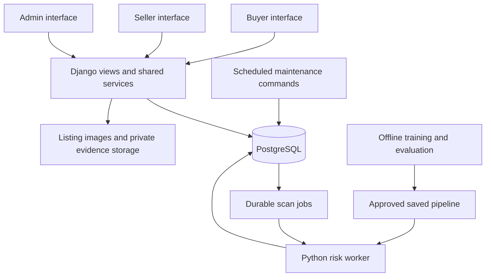

# Technology Stack

**Project:** Second-hand Marketplace & Product Fraud Risk Detection Database Application

**Related requirements:** [PRD.md](PRD.md), version 2.1

**System design:** [ARCHITECTURE.md](ARCHITECTURE.md)

**Updated:** 3 November 2026

**Status:** Recommended implementation baseline; installation, implementation and verification are pending.

## 1. Recommended Stack

Use **Python + Django + PostgreSQL + Django Templates + Bootstrap + JavaScript + scikit-learn**, with a separate Python worker for fraud risk assessments.

This stack supports the project's relational database requirements and keeps backend services, feature extraction and machine learning in Python. Buyer, Seller and Admin have separate interfaces and access boundaries while sharing one identity store, database and business service layer.

PostgreSQL, Python, scikit-learn and the initial Random Forest algorithm are agreed choices in the PRD. This document recommends Django and the supporting technologies as the web implementation baseline. It does not change the PRD's requirements.

| Layer or responsibility | Technology | Where to apply it |
| --- | --- | --- |
| Main programming language | Python 3.13 | Backend, worker, dataset generation, training, evaluation and maintenance commands |
| Backend framework | Django 5.2 LTS | Request handling, forms, authentication, authorization integration, business services, ORM and migrations |
| Page rendering | Django Templates and HTML | Buyer, Seller and Admin pages and reusable page components |
| Styling | Bootstrap 5.3 and custom CSS | Responsive layouts, navigation, listing cards, forms, tables and risk indicators |
| Browser interactions | JavaScript with `fetch()` | Chat polling, scan-status refresh, image previews and small interface updates |
| Database | PostgreSQL 18 | Operational records, immutable history, constraints, transactions, search and durable scan jobs |
| Database driver | Psycopg 3, distributed as `psycopg` | Connect Django and Python services to PostgreSQL |
| Accounts and roles | Django authentication, groups, permissions and database-backed sessions | Shared identity, buyer/seller memberships, administrator access and session handling |
| Password hashing | Django `BCryptSHA256PasswordHasher` with `bcrypt` | Framework-managed password storage matching the PRD |
| Listing search | PostgreSQL full-text search and GIN indexes | Search current listing titles/descriptions and combine with filters |
| Machine learning toolkit | scikit-learn | Preprocessing pipelines, training, validation, evaluation and inference |
| Initial learning algorithm | `RandomForestClassifier` | Structured listing-risk classification |
| Dataset preparation | pandas and NumPy | Dataset inspection, preparation and reproducible experiments |
| Model persistence | joblib | Save and load the fitted preprocessing/classifier pipeline |
| Background processing | Django management command running a Python worker | Claim and process PostgreSQL scan jobs independently of browser requests |
| Scheduled maintenance | Management commands plus an OS scheduler | Expire unanswered orders and schedule daily reassessments |
| Image validation | Pillow | Decode images and check supported formats and dimensions |
| File storage | Local filesystem initially | Store listing images, private report evidence and trusted model artifacts |
| Automated testing | pytest and pytest-django | PostgreSQL integration tests, permissions, state transitions, worker recovery and feature tests |
| Code checks and dependencies | Ruff, `venv`, pip and pinned requirements | Formatting/lint checks, isolated environments and reproducible dependency installation |
| Version control | Git and the configured GitHub repository | Application source, migrations, documentation and reproducibility manifests |
| Hosted deployment | Linux, Gunicorn and Nginx | Production web serving, with supervised worker and scheduled commands |

### Version policy

- Use current patched releases within the selected Python 3.13, Django 5.2 LTS, PostgreSQL 18 and Bootstrap 5.3 families.
- Select stable compatible releases of other libraries during implementation; pin exact resolved versions and record transitive dependencies.
- Keep training and inference dependencies aligned. Each registered model records its dependency manifest, feature schema and dataset version.
- Record the PostgreSQL version and deployment environment separately from Python package requirements.
- Re-run relevant checks after dependency upgrades, and validate existing model artifacts before activation in a changed environment.

Django 5.2 supports Python 3.13 and receives extended support through April 2028. PostgreSQL 18 is supported through November 2030. These are baseline choices, not a requirement to use the newest major release available.

## 2. Application Architecture

Use one repository and one Django backend deployment containing three distinct application modules.

| Application | Module | Entry point | Responsibilities |
| --- | --- | --- | --- |
| Buyer App | `buyer_app` | `/buyer-app/` | Public catalog, search, listing details, risk warnings, buyer login, purchases, conversations, reports and case history |
| Seller App | `seller_app` | `/seller-app/` | Seller login, drafts, publication, revisions, image uploads, sales, fulfilment, conversations and listing risk history |
| Admin App | `admin_app` | `/admin-app/` | Restricted login, review queue, evidence decisions, moderation, disputes, model/rule management, exports and audit lookup |

Each module owns its URLs, views, forms, templates and navigation. Shared services own the business operations so the applications enforce the same rules and read the same records.

Django's built-in administration interface may support restricted development tasks. The custom Admin App must implement the PRD's moderation workflows and audit requirements.



## 3. Frontend Responsibilities

Use Django Templates to render database-backed pages. Apply Bootstrap for responsive layouts and interface components, then add custom CSS for the marketplace's appearance.

Use JavaScript for chat polling at the proposed five-second interval, assessment-status refresh, image previews and small interactions. Ordinary workflows use Django forms and server-side validation. JSON endpoints support polling where needed.

- Mutations use authenticated, CSRF-protected POST requests.
- Escape user text; do not accept user-authored HTML.
- Display risk with text as well as colour.
- Distinguish pending, scanning, ready, failed and stale assessments.
- Include pagination, labels, keyboard access and mobile layouts.
- Keep Bootstrap assets locally for a demonstration that does not depend on a CDN.

The P0 baseline does not require a separate JavaScript frontend build or REST framework.

## 4. Backend and Shared Business Services

Use Django views to receive requests, forms to validate inputs, and shared services to execute business operations. Keep complex mutations out of templates and avoid implementing separate copies in each application.

| Example service | Required behaviour |
| --- | --- |
| `publish_listing()` | Check seller access; create a revision and image associations; advance current content and queue assessment atomically |
| `place_order()` | Check buyer access; lock the product; verify availability; create the order/history and reserve the product atomically |
| `transition_order()` | Validate actor and state; apply the change and append history in one transaction |
| `send_message()` | Verify conversation participation, account status, message length and rate limits |
| `record_moderation_decision()` | Serialize the revision's decision chain and record the decision and audit event atomically |
| `activate_model()` | Validate the registered artifact; audit activation and schedule recoverable batches of reassessments |

Service names are illustrative. Every protected operation must check role, account status and object ownership on the server, including direct requests to object URLs.

### Accounts and sessions

Create the custom email-login user model before the first migration. Enforce case-insensitive email uniqueness in PostgreSQL and use Django groups as the source of role membership. Public registration must never grant administrator access.

Use shared database-backed sessions and separate role-aware login entry pages. Switching applications changes navigation, not membership. Keep marketplace blocking separate from blanket authentication disablement so blocked members can access the history and fulfilment workflows required by the PRD.

Configure `BCryptSHA256PasswordHasher` as the preferred hasher and install its `bcrypt` dependency. Django's default password hasher is PBKDF2, so the PRD's bcrypt requirement needs explicit configuration. Use Django password APIs and validators.

Login throttling and message/listing/report rate limits require explicit implementation and verification; installing Django does not complete these requirements.

## 5. PostgreSQL Responsibilities

Use PostgreSQL throughout development, integration testing and deployment. SQLite does not verify this project's PostgreSQL-specific guarantees.

| Database capability | Application |
| --- | --- |
| Foreign keys | Preserve relationships among users, products, revisions, orders, reports and predictions |
| Check constraints | Enforce valid prices, bounded risk scores and allowed status values |
| Unique and partial unique indexes | Enforce normalized email uniqueness, request idempotency, one-sale protection and job/result deduplication |
| Transactions | Commit business changes together with their required history and audit records |
| Row locks | Protect concurrent purchases, order transitions, moderation decisions and worker claims |
| Validation triggers | Protect selected state transitions and immutable historical records from invalid direct SQL changes |
| Queue-creation triggers | Insert durable scan jobs in the publication/context transaction |
| GIN full-text indexes | Search listing title/description efficiently |
| B-tree indexes | Support filters, conversations, order history, report queues and job lookup |
| SQL views | Expose current assessment state, administrator queues and seller order history |
| Database privileges | Prevent ordinary runtime updates/deletes of protected audit and history records |

Use Django ORM operations for ordinary queries and mutations. Use versioned SQL migrations for constraints, triggers and views requiring explicit database control. Include representative SQL and `EXPLAIN ANALYZE` evidence in the academic deliverables.

### Composite revision references

The PRD specifies revision identities and foreign keys using `(product_id, revision_no)`. Django 5.2 supports composite primary keys, but ordinary `ForeignKey` fields cannot reference them.

Resolve the ORM mapping before creating the schema. To preserve the PRD's exact design, use explicit revision fields, deliberate query/service code and custom SQL migrations for composite foreign keys and the deferrable current-revision relationship. Keep database schema and migration state consistent.

A conventional surrogate revision ID is an alternative design, but adopting it requires updating the ERD, data dictionary and affected PRD references while preserving equivalent integrity. Do not silently substitute it during implementation.

## 6. Machine Learning Responsibilities

The algorithm, library and fitted model are different things:

- **Random Forest:** the initial learning algorithm.
- **scikit-learn:** the Python toolkit used to train and run it.
- **Saved fitted pipeline:** the trained preprocessing and classifier used for inference.

### Offline training and evaluation

1. Generate or export versioned records matching the PRD's feature contract.
2. Preserve provenance, synthetic flags, grouping keys, timestamps and label sources.
3. Split related records before fitting preprocessing, tuning or choosing thresholds.
4. Train preprocessing and the classifier as one pipeline with fixed seeds.
5. Compare rules, Logistic Regression and Random Forest on identical partitions.
6. Record precision, recall, F1, average precision, confusion matrices and false-positive examples.
7. Report synthetic and real-data performance separately, with sample counts and limitations.
8. Save the fitted pipeline, checksum, dependency manifest, dataset/split versions, class mapping and evaluation results.
9. Register the immutable model version and require explicit administrator activation.

Use pandas and NumPy for preparation and analysis. Save the fitted pipeline with joblib. Load only trusted project-produced artifacts, using compatible training/inference environments. Retraining creates a new offline model version.

### Runtime inference

The worker calculates the versioned features defined in the PRD: price ratio, keyword count, seller account age, prior confirmed fraud count, posting frequency, image count, location difference and duplicate-text count.

Feature extraction must use only information eligible at `feature_as_of`. Preserve the feature snapshot and reference values so retries and historical review remain reproducible. Shared feature definitions keep training and inference consistent.

The score is a risk indicator. It does not establish fraud or automatically justify blocking a member. Preserve human review and evidence-backed decisions. A failed or missing assessment must never become a zero score or low-risk badge.

## 7. Worker and Scheduling

Run one dedicated Python scan worker initially, implemented as a Django management command. Use the PostgreSQL `risk_scan_jobs` table as the durable queue.

The queue is application functionality to implement, not an automatic Django feature. Required behaviour includes:

- Transactional trigger-based queue insertion when publication or assessment context changes.
- Deduplication matching the PRD's bound/unbound job rules.
- Short claim transactions using row locks such as `FOR UPDATE SKIP LOCKED`.
- Feature extraction and inference outside long-held claim locks.
- Persisted feature snapshots, model/ruleset bindings and assessment timestamps.
- Lease expiry, claim tokens, bounded retries and recovery after worker interruption.
- Atomic, claim-checked result insertion and job completion.
- One result per job, even when execution is repeated.
- Current-result checks for revision, context, active model/ruleset and maximum assessment age.

Triggers perform local queue writes only. They must not run model training, inference or external requests. Listing publication can commit while the worker is stopped; the durable job remains available for later processing.

Use separate scheduled management commands for unanswered-order expiry and daily reassessment. Initially, orders expire after 48 hours only while still `placed`; reassessment runs daily for available listings. Scheduled operations must be idempotent and recoverable.

Use Windows Task Scheduler during native Windows development and systemd timers or cron on a Linux deployment. Do not start maintenance schedules from web-process initialization.

## 8. Images, Evidence and Configuration

Use Pillow to decode uploads and verify format and dimensions. Apply the PRD limits: JPEG/PNG/WebP, up to 5 MB per image, at most six listing images and three report evidence images. Enforce request-level limits as well as per-file validation.

Store file contents on disk initially and store generated storage keys and metadata in PostgreSQL. Separate public listing images from private evidence. Private evidence is served only after authorization checks; it must not be exposed through a public media URL.

Preserve historical file contents and revision associations. Replacements create new files. Back up the database and referenced media together and verify a restore into a separate test environment.

Load secrets from environment configuration. Commit placeholder examples, not real database credentials, session secrets or administrator passwords. Separate migration/owner database credentials from runtime credentials so database-level history protections remain enforceable.

## 9. Proposed Repository Layout

```text
SecondHandFraudDB/
|-- config/                       # Settings, main URLs and WSGI entry point
|-- accounts/                     # Custom user, sessions and role workflows
|-- buyer_app/                    # Buyer URLs, views, forms and templates
|-- seller_app/                   # Seller URLs, views, forms and templates
|-- admin_app/                    # Administrator application workflows
|-- marketplace/
|   |-- models/                   # Listings, orders, chat and reports
|   |-- services/                 # Shared business operations
|   |-- queries/                  # Search, dashboards and history queries
|   `-- migrations/               # Schema migrations and explicit SQL
|-- risk/
|   |-- models.py                 # Jobs, model/rule metadata and predictions
|   |-- features.py               # Versioned feature extraction
|   |-- inference.py              # Approved model loading and prediction
|   `-- management/commands/      # Worker, refresh and maintenance entry points
|-- ml/
|   |-- datasets/                 # Generator/export code and manifests
|   |-- training/                 # Pipeline training and baselines
|   `-- evaluation/               # Evaluation code and result summaries
|-- templates/                    # Shared page components
|-- static/                       # Bootstrap, custom CSS and JavaScript
|-- tests/                        # Integration, permission and feature tests
|-- requirements/                # Pinned dependency files
|-- .env.example                  # Configuration placeholders
|-- manage.py
|-- PRD.md
`-- TECH_STACK.md
```

These are planned paths. Uploaded media, private datasets and model artifacts use configured storage locations; keep sensitive contents out of Git and publicly served source directories.

## 10. Development and Deployment

### Local Windows development

- Install Python 3.13 and PostgreSQL 18; pgAdmin is optional for database inspection.
- Create a project virtual environment and install the pinned Python dependencies.
- Use Django `runserver` for local development.
- Start the risk worker in a separate process.
- Invoke scheduled maintenance through Task Scheduler or manually during controlled tests.
- Keep Bootstrap assets local and use deterministic seed data for repeatable demonstrations.

### Hosted deployment

- Use a Linux host with Nginx forwarding application requests to Gunicorn.
- Run the web service and risk worker as separately supervised processes.
- Use a systemd timer or cron for scheduled commands.
- Provide persistent PostgreSQL, media and artifact storage.
- Configure HTTPS, secure session cookies, allowed hosts, CSRF settings and `DEBUG=False`.
- Log request/job identifiers, failures, queue age and active model/ruleset versions without exposing private content or secrets.
- Run Django's deployment checks and verify database/media backup restoration.

Gunicorn targets UNIX environments; it is part of the Linux deployment baseline. Django's development server is not the public deployment server.

Docker Compose is optional for reproducible packaging. The core demonstration can run locally without paid AI APIs, a payment gateway or an external message broker. Public hosting and storage may incur costs.

## 11. Verification

Use pytest and pytest-django with PostgreSQL. Select transaction-aware tests and independent database connections for concurrency scenarios; ordinary transaction-wrapped unit tests alone do not demonstrate competing purchases.

| Area | Required evidence |
| --- | --- |
| Access boundaries | Buyer-only, seller-only, administrator, blocked and unrelated accounts receive the correct access |
| Revision integrity | Orders/reports retain their target revision; historical content remains immutable |
| Concurrent orders | Two buyers produce exactly one successful non-cancelled order |
| Order transitions | Invalid actors/transitions fail; valid changes commit with history |
| Worker recovery | Queued jobs survive interruption; expired claims recover without duplicate results |
| Assessment freshness | Old revisions, retired models, old rules and expired snapshots cannot appear current |
| Private evidence | Authorized access succeeds and unrelated access fails |
| Audit atomicity | Audit-insert failure rolls back the associated privileged mutation |
| Model reproducibility | Dataset/split manifests, dependencies and saved pipeline support documented evaluation |
| Recovery and performance | Restore drill and measured course-scale targets match the PRD's acceptance criteria |

Use manual browser checks for warning text, keyboard access, responsive layouts and the complete Buyer/Seller/Admin demonstration. Record measured results rather than assumed performance.

## 12. Implementation Order

1. **Finalize design:** ERD, revision mapping, role matrix, listing language, currency, locations and feature contract.
2. **Create foundations:** Django project, custom user, PostgreSQL migrations, groups and three application entry points.
3. **Build listings:** Revisions, image validation, publication, search and transactional job creation.
4. **Complete Buyer/Seller operations:** Conversations, atomic orders, fulfilment, expiry and private reporting.
5. **Build the dataset/model pipeline:** Generator/export, provenance, leakage checks, baseline comparisons and model registration.
6. **Integrate Admin and risk operations:** Worker recovery, current-risk display, moderation, audits, model activation and rescans.
7. **Verify delivery:** Acceptance tests, concurrency, performance, backup restoration and end-to-end demonstration.
8. **Add optional extensions:** Appeals, notices and analytics after P0 acceptance checks pass.

## 13. Optional Technologies and Adoption Triggers

| Technology | Consider when |
| --- | --- |
| React and a dedicated REST API | Rich client-side interaction or additional clients justify a separate frontend/API boundary |
| Django REST Framework | A substantial, reusable API becomes a project requirement |
| WebSockets and Django Channels | Measured messaging requirements justify replacing polling |
| Redis and Celery | Task volume or orchestration needs justify operating a broker-backed queue; preserve equivalent durability and recovery guarantees |
| Object storage | Multiple hosts or media/storage requirements exceed the local-storage baseline |
| Separate FastAPI inference service | Inference needs an independently deployed API or scaling boundary |

These additions are outside the initial stack and must not delay the PRD's P0 workflow. Real payments, identity verification, image forgery detection and automatic online learning remain outside the current scope.

## 14. Official References

- [Django supported versions](https://www.djangoproject.com/download/)
- [Django and Python compatibility](https://docs.djangoproject.com/en/5.2/faq/install/)
- [Django authentication](https://docs.djangoproject.com/en/5.2/topics/auth/)
- [Django password management](https://docs.djangoproject.com/en/5.2/topics/auth/passwords/)
- [Django PostgreSQL full-text search](https://docs.djangoproject.com/en/5.2/ref/contrib/postgres/search/)
- [Django composite primary keys and relationship limitations](https://docs.djangoproject.com/en/5.2/topics/composite-primary-key/)
- [Django deployment checklist](https://docs.djangoproject.com/en/5.2/howto/deployment/checklist/)
- [PostgreSQL version support](https://www.postgresql.org/support/versioning/)
- [PostgreSQL row locking](https://www.postgresql.org/docs/18/sql-select.html)
- [Psycopg 3](https://www.psycopg.org/)
- [Bootstrap 5.3 setup](https://getbootstrap.com/docs/5.3/getting-started/introduction/)
- [scikit-learn Random Forest](https://scikit-learn.org/stable/modules/generated/sklearn.ensemble.RandomForestClassifier.html)
- [scikit-learn common pitfalls](https://scikit-learn.org/stable/common_pitfalls.html)
- [scikit-learn model persistence](https://scikit-learn.org/stable/model_persistence.html)
- [Gunicorn](https://github.com/benoitc/gunicorn)
