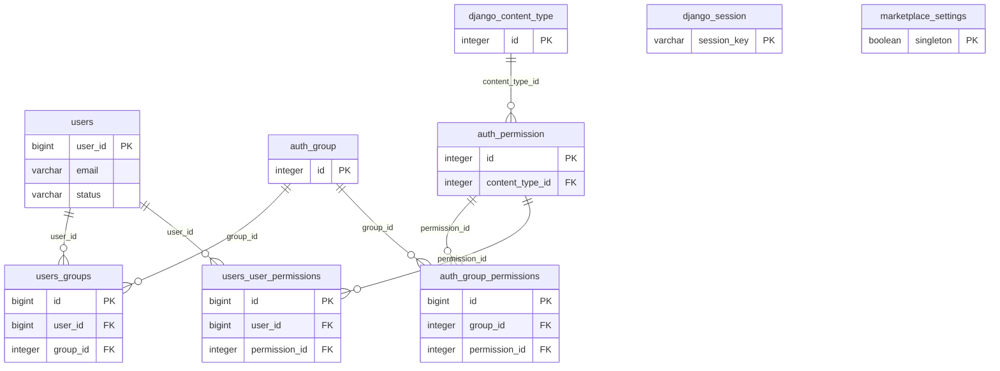
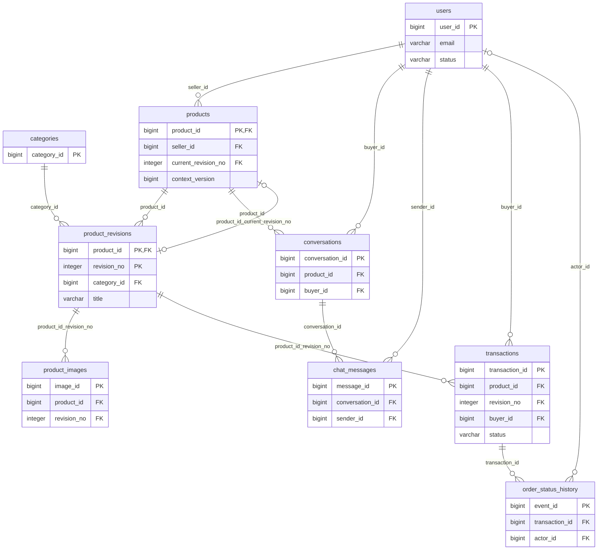
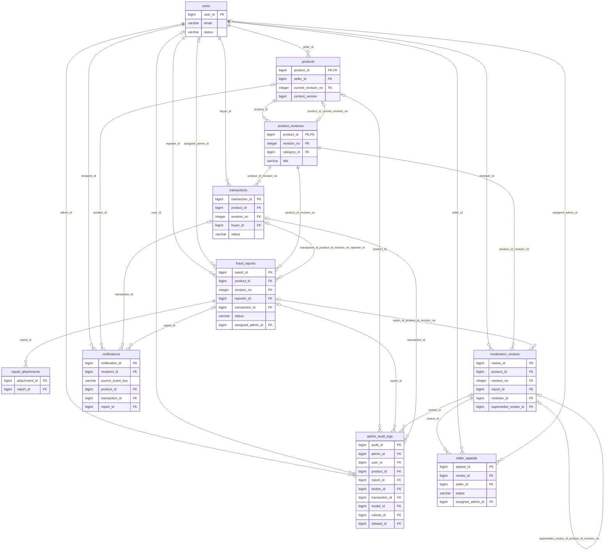
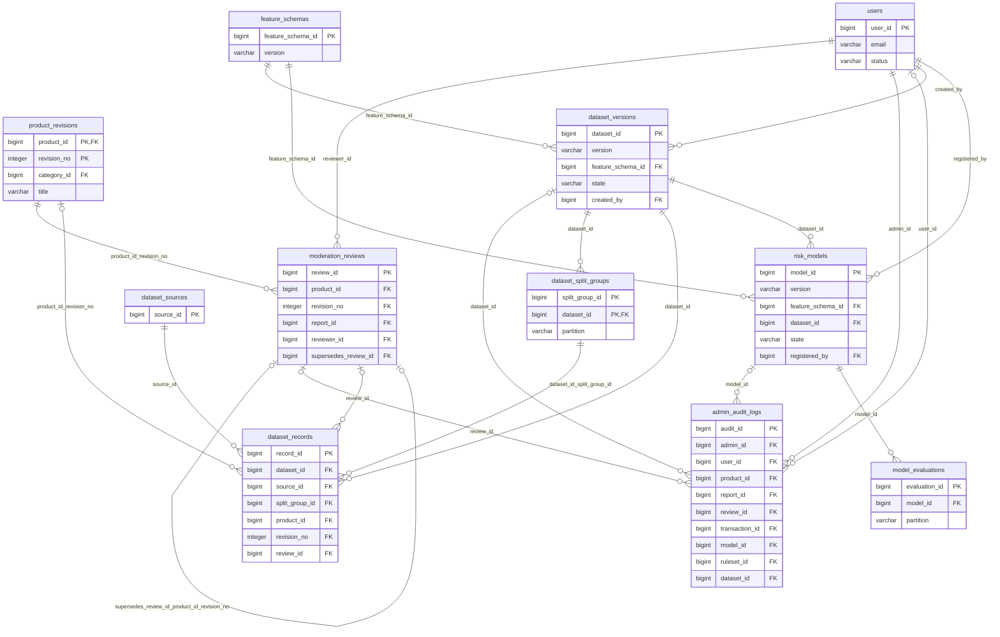
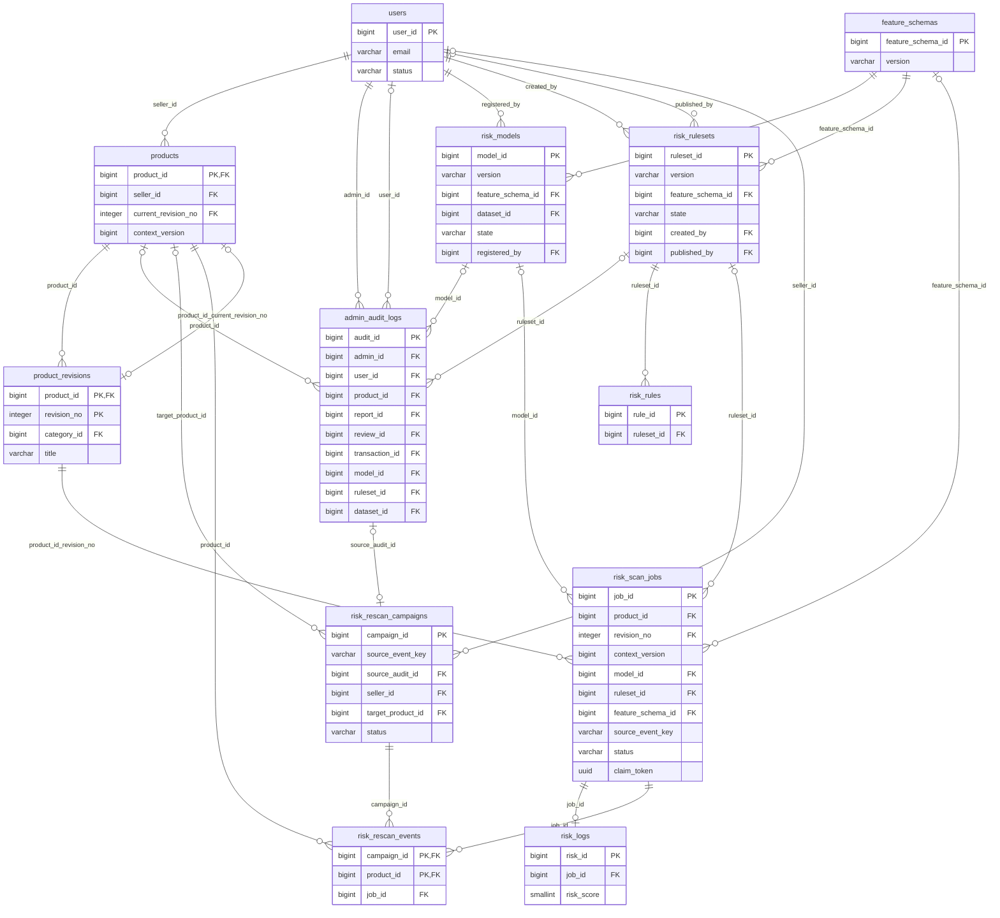
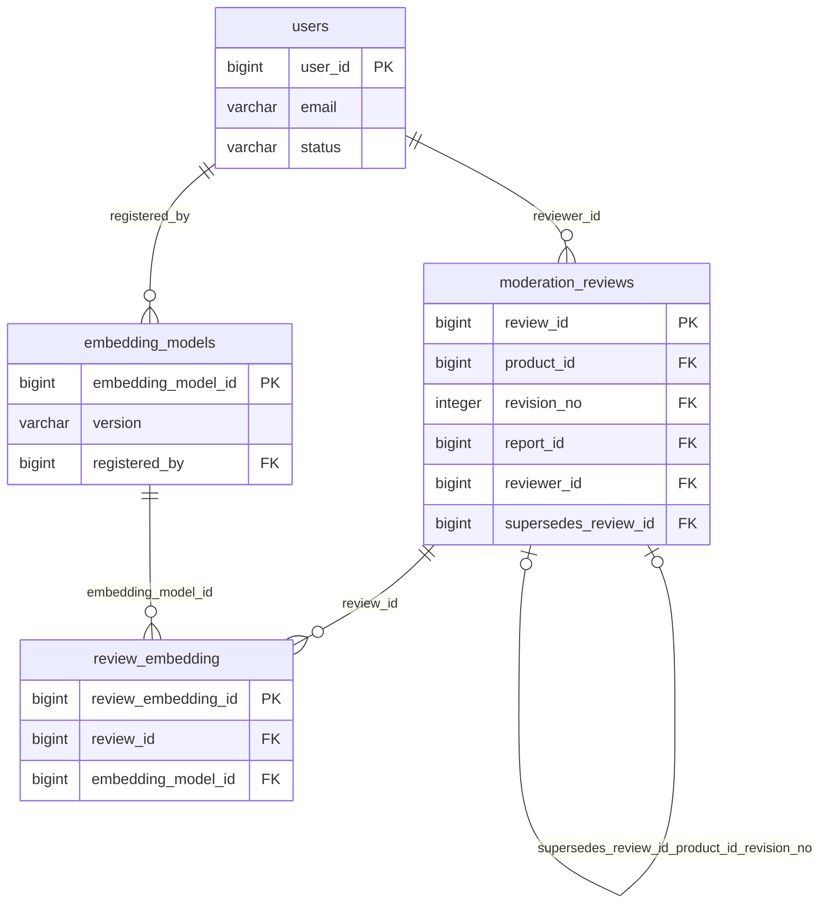

# Entity–Relationship Diagrams

These diagrams map the physical PostgreSQL schema. They are split for readable assessment and printing; together they cover every base table, including Django infrastructure and optional extensions. Exact composite foreign keys, conditional uniqueness and checks are listed in the [relational schema](RELATIONAL_SCHEMA.md) and [data dictionary](DATA_DICTIONARY.md).

**Legend:** `||` exactly one; `o|` zero or one; `o{` zero or many. The parent-side optional marker follows nullable foreign keys. A diagram showing zero children means a parent may exist before children are inserted; lifecycle checks can require a child later. PK/FK labels identify key columns. The deferrable product/current-revision relationship forms a deliberate cycle with product/revision ownership.

A high-risk AI prediction is an observation. Confirmed fraud/legitimacy comes only from the moderation decision chain. `fraud_logs` and `risk_score_history` are views, so they do not appear as duplicate entities.

## Identity, Django infrastructure and deployment settings

[Download Mermaid source](../diagrams/database-identity.mmd)

## Listings, messaging and orders

[Download Mermaid source](../diagrams/database-marketplace.mmd)

## Reports, moderation, audit and P1 extensions

[Download Mermaid source](../diagrams/database-moderation.mmd)

## AI datasets, grouping, model provenance and evaluation

[Download Mermaid source](../diagrams/database-ai-provenance.mmd)

## AI execution, versioned rules and rescan recovery

[Download Mermaid source](../diagrams/database-ai-execution.mmd)

## Optional P2 review embeddings

[Download Mermaid source](../diagrams/database-embeddings.mmd)

## Cardinality refinements

- `products → product_revisions`: a draft can exist without a revision; publication requires a valid current revision. Both product ID and revision number participate in every historical link.
- `transactions`: the product can have several cancelled orders, but a partial unique index permits at most one non-cancelled order, including a completed sale.
- `product_images` and `report_attachments`: bounded unique positions enforce at most six listing images and three private attachments respectively.
- `risk_scan_jobs → risk_logs`: a job has zero or one result and a deferred consistency trigger requires the result and succeeded state to commit together.
- `moderation_reviews`: partial root uniqueness and predecessor uniqueness form one nonbranching chain per revision; a correction must name the current chain head.
- `risk_models`/`risk_rulesets`: there may be many registered versions, but each has at most one active row, and active configuration must be compatible.
- Campaign/product receipts are many-to-many membership records, with `(campaign_id, product_id)` as their composite primary key.
- `django_session` has no user foreign key because Django stores framework session data; authorization must decode/validate it through Django.

Regenerate these sources after schema edits with `python docs/database/generate_reference.py`. Mermaid renders in Markdown viewers that support it. The source files can also be imported into Mermaid tooling for SVG/PDF export.
